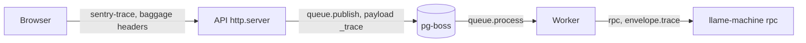

# Observability

Each llame process reports to Sentry only when it has a DSN; without one it
sends nothing. Use one Sentry project per process kind, so each project's
issues and performance views cover one runtime: the web app, the API and its
workers, and the Machine daemon.

| Process                                      | DSN                      | Environment (default `local`)    |
| -------------------------------------------- | ------------------------ | -------------------------------- |
| `apps/web`, built                            | `NEXT_PUBLIC_SENTRY_DSN` | `NEXT_PUBLIC_SENTRY_ENVIRONMENT` |
| API (`dist/main`) and worker (`dist/worker`) | `SENTRY_DSN`             | `SENTRY_ENVIRONMENT`             |
| `llame-machine` on a box                     | `SENTRY_DSN`             | `SENTRY_ENVIRONMENT`             |

The `NEXT_PUBLIC_*` values are compiled into the web build; set them before
`next build`. The API reads its variables at process start, from the
environment or `apps/api/.env.local`. Set `SENTRY_RELEASE` on any process to
tag its events with a release. Name a deployed environment `production`;
development checkouts and worktrees use `development`, and anything unset
reports as `local`.

## What is reported

- Unhandled API errors (HTTP 5xx). `HttpException` responses such as 400 and
  404 are control flow and are not reported.
- Failed Runs: a provider or tool-loop failure that ends a Run as `failed`,
  tagged with `llame.run_id` and `llame.chat_id`. A cancelled or superseded
  Run is not reported.
- Each failed pg-boss job attempt. pg-boss retries the job, so one failing job
  can produce one event per attempt.
- Unexpected Machine operation failures. A refusal the daemon sends the hub
  (invalid params, outside a root, budget exhausted) is not reported.

API events carry the opaque id of the signed-in user or the Run's owner, and
the process tag `llame.process` (`api`, `worker`, or `machine`).

## Traces

One trace follows a request from the browser through the API, into the queued
job that executes it, and onto the Machine that runs its tool calls:



- The browser adds trace headers only to requests for `NEXT_PUBLIC_API_URL`.
- Queue spans follow Sentry's Queues module (`queue.publish`,
  `queue.process`) and the messaging semantic conventions: names are
  `send <queue>` and `process <queue>`, with `messaging.*` attributes for the
  message id, body size, retry count, and receive latency. Sentry's Queues
  view shows each queue's throughput, latency, and retries. The sender's trace
  travels in the job payload's `_trace` field.
- Machine calls are `rpc` spans named `llame-machine/<method>` on both ends,
  with `rpc.*` and `jsonrpc.*` attributes. The trace travels in the request
  envelope; a daemon without Sentry ignores it.
- The API also traces HTTP routes, Nest handlers, and Postgres queries.

The API and the daemon send no trace headers on their own outgoing HTTP
requests: model providers, MCP servers, and web reads never receive them.

## Agent tracing

Every model call is an AI span in Sentry's Agents view: an `invoke_agent`
span per request, with the model, token usage, tool calls, and latency. The
agent is named after the request's lane: `chat-main` for a Chat's turns and
compaction, `chat-title` for title generation, and `chat-search` for search
requests. Each Run sets the Chat's id as the conversation id and its owner's
opaque id as the user, so a Chat's turns appear as one conversation.

## Data sent

Model traffic is sent in full: system prompts, messages, model output, and
tool arguments and results, because agent tracing and conversation
transcripts are built from them. Model context never contains a secret llame
resolved, but tool output contains whatever a tool returned, including what
a host command printed. To keep transcripts out of Sentry, set
`genAI: { inputs: false, outputs: false }` in
[`apps/api/src/instrument.ts`](../../../apps/api/src/instrument.ts); spans
keep the model, usage, and timing.

Nothing else leaves a process beyond structure: request and response bodies
and headers, cookies, query strings, database query parameters and results,
queue payloads, and stack-frame variables are not collected. Error messages
and stack traces are sent as written; llame does not put secrets in errors or
logs.

The web app keeps its own SDK defaults, including Session Replay with text
masked.

## Machine daemon

The hub starts the daemon through the forced command in the box user's
`authorized_keys`, so set the variables there:

```text
restrict,command="SENTRY_DSN=https://... SENTRY_ENVIRONMENT=production /usr/local/bin/llame-machine serve --stdio" ssh-ed25519 AAAA... llame-hub
```

sshd runs the command through the user's login shell, which applies the
assignments. The DSN is a public client key, but it lets anyone send events to
that project, so treat the line like the rest of `authorized_keys`.
