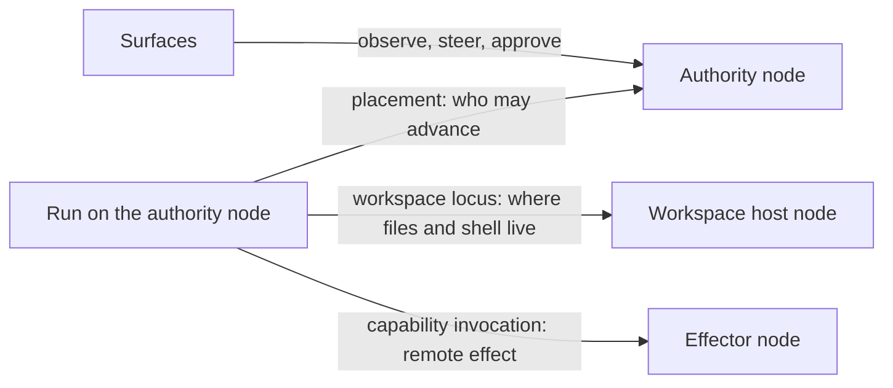

# Multi-device execution placement

The question: how do reference systems put agent work on machines other than
the one running the chat, and what should llame build so that a headless
development box and a headed desktop work first, while phones, home hubs with a
wake word, and disposable cloud sandboxes fit later without a redesign.

This note extends two existing studies rather than restating them. The
[local-node research](2026-08-21-local-nodes-workspaces-and-distributed-execution.md)
owns Node, Surface, Executor, Workspace, Sandbox, the Node Protocol modules,
enrollment, fenced handoff, and outage policy. The
[OpenClaw placement study](2026-09-27-openclaw-sandboxes-and-cloud-workers.md)
owns OpenClaw's session placement state machine and Crabbox. Evidence here comes
from the harness entries in [harnesses](../harnesses/index.md) and from
primary documentation of OpenClaw nodes, Home Assistant voice, Coder, Tailscale,
Claude Code self-hosted environments, Codex cloud, and the Dev Container
specification. All of it is documentation or source reading; nothing was run.

## Verdict

llame's existing vocabulary is the right skeleton, and no reference covers the
combination llame wants: late-bound, model-requested Workspace entry, a
multi-tenant hub, and device capabilities beyond a shell. Three gaps remain in
the recorded design, and one of them decides the first headless-box cut.

- **G1. Run authority and tool locus are conflated.** The local-node research
  moves a Run to another node as a new execution segment. Coder, OpenClaw nodes,
  and Claude Code runners show a third shape: the agent loop stays where the
  credentials and Chat state live, and only tool calls cross to the box. That
  shape needs no checkpoint transfer, no handoff fence, and no provider
  credentials on the box.
- **G2. There is no device-capability model.** `execution.*` covers Runs,
  Workspaces, approvals, and steering. Camera, notifications, screen, GUI
  presence, audio, and location are none of those. OpenClaw's `node.invoke`
  with declared capability claims and server-side allowlists is the only worked
  design.
- **G3. Data direction for disposable Sandboxes is undecided.** The OpenClaw
  study's open question Q1 (registered Workspaces run where they live; disposable
  Sandboxes receive a working copy and publish back) still has no answer.
- **G4. Attention and approval routing are unspecified.** The research lets any
  authorized surface approve, but not which device to interrupt when a Run on a
  headless box needs a human.

Recommendation, moderate confidence: ship headless boxes as **enrolled
executor-only nodes that dial out to the hub and serve the existing native tool
contracts** for directories registered on the box, with the Run loop staying on
the hub worker. A headed computer runs the same daemon and additionally
advertises display, presence, notification, and local-approval facts. Every
future device class plugs in through declared capability families on the same
handshake.

## 1. Placement shapes in the references

| Shape                                      | Durable state owner      | What runs on the remote machine                            | Examples                                                                                                                                                                                                                                                                                      |
| ------------------------------------------ | ------------------------ | ---------------------------------------------------------- | --------------------------------------------------------------------------------------------------------------------------------------------------------------------------------------------------------------------------------------------------------------------------------------------- |
| S1. Box daemon runs peer agent CLIs        | the box daemon           | daemon plus vendor CLIs in tmux or PTYs, in worktrees      | [Shipyard](../harnesses/shipyard.md), [bb](../harnesses/bb.md), [Paseo](../harnesses/paseo.md), [MonoCode](../harnesses/monocode.md), [Superset](../harnesses/superset.md), [Ghostex](../harnesses/ghostex.md), [Jean](../harnesses/jean.md) headless, [Orca](../harnesses/orca.md) SSH hosts |
| S2. Control plane owns the loop or session | the control plane        | a thin agent that executes tools or worker turns           | OpenClaw nodes and cloud workers, Coder workspace agent[^coder-agents-architecture], Claude Code self-hosted runners[^cc-self-hosted], [Kandev](../harnesses/kandev.md) `agentctl`, [OpenHands](../harnesses/openhands.md) Agent Server                                                       |
| S3. Per-tool remote terminal backend       | the single agent process | a shell in Docker, SSH, Modal, and similar                 | [Hermes Agent](../harnesses/hermes-agent.md) `TERMINAL_ENV`, [Loki](../harnesses/loki.md)                                                                                                                                                                                                     |
| S4. Disposable hosted environment          | the vendor control plane | a container or VM built from a recipe, torn down after use | Codex cloud[^codex-cloud], Claude Code cloud, Codespaces, [Conductor](../harnesses/conductor.md) Cloud, [Orca](../harnesses/orca.md) recipes, [Omnigent](../harnesses/omnigent.md) sandbox providers, [AX](../harnesses/ax.md)                                                                |
| S5. Peripheral capability node             | the hub                  | a device agent exposing declared commands, no agent loop   | OpenClaw macOS, iOS, Android, watchOS nodes[^oc-nodes-index], Home Assistant voice satellites[^wyoming-readme], tasker-mcp[^tasker-mcp]                                                                                                                                                       |

S1 is the most common shape among coding harnesses because the box is where
the repository lives and the vendor CLI already owns the loop. It gives up
Chat-level provenance: the transcript belongs to the vendor CLI, and llame would
become a second session system, which VISION rejects for peer adapters. S2 is
the only shape in which the control plane can fence an executor, and every
system that fences (OpenClaw, Claude runners) is S2. S5 is the only shape that
treats a phone or speaker as more than a remote control.

Every phone in the bundle except OpenClaw's is a steering client: Orca,
Agentastic, Superset, Paseo, Ghostex, Orchestrator, Conductor, T3 Code, and
Tortie pair a phone to watch and type, not to act. No harness entry mentions a
wake word, a satellite, a Raspberry Pi, a camera, or screen capture as a
placement concern; those appear only in OpenClaw nodes and Home Assistant.

## 2. Mechanisms compared

### 2.1 Enrollment and identity

| System             | Credential                                                                                                   | Revocation                                                        | Notable property                                                                                                 |
| ------------------ | ------------------------------------------------------------------------------------------------------------ | ----------------------------------------------------------------- | ---------------------------------------------------------------------------------------------------------------- |
| Shipyard           | Ed25519 key per install; single-use 256-bit pairing code proven by HMAC over TLS exported keying material    | `berthd revoke` closes live shells and streams within seconds     | the code never crosses the wire; invites reuse an already pinned connection                                      |
| OpenClaw           | signed device keypair plus a 10-minute single-use bootstrap token; separate capability approval[^oc-pairing] | removing the node role drops its approved surface and disconnects | admission and capability grant are two records; SSH-verified auto-approval compares device id **and** public key |
| Paseo Hub          | daemon persists relationship id and private credential before enrollment                                     | close code 4403 is permanent revocation                           | the hub gets presence and zero execution rights until `hub.execute` is granted                                   |
| Superset           | org-scoped API key claimed to the key's user on first host registration                                      | per-host member grants                                            | headless enrollment without a browser on the box                                                                 |
| Coder              | agent token or cloud instance identity (AWS, Azure, GCP)                                                     | workspace deletion                                                | enrollment is provisioning; no user-facing pairing for ephemeral machines                                        |
| Tailscale          | auth key admits a node key; ephemeral and tagged variants[^tailscale-auth-keys]                              | deleting the node; revoking the auth key does **not** deauthorize | the join credential and the device identity are separate objects                                                 |
| Claude Code runner | environment secret, then runner token, then a session-scoped OAuth token                                     | lease lapse                                                       | a runner serves one owner at a time, so checked-out code never mixes between owners                              |

The local-node research already selects disposable node keypairs, OAuth or a
device link to authorize enrollment, and narrow renewable credentials (§5.16).
The references add three refinements: separate transport admission from
capability grant (OpenClaw), re-approve when the declared capability surface
changes (OpenClaw), and keep the join token distinct from the enrolled identity
so revoking a leaked invite does not silently leave a device enrolled
(Tailscale's documented gap).

### 2.2 Reachability and version skew

The host dials out in every authenticated design: OpenClaw nodes open a
WebSocket to the Gateway, Coder's agent opens the tunnel the control plane then
reaches back through[^coder-networking], and Claude runners poll so that "Anthropic
never connects into your network". Shipyard refuses to start without a tailnet
address and runs pinned mutual TLS on top. The one inversion, Home Assistant
connecting to a Wyoming satellite, is unauthenticated by design and limited to a
trusted LAN[^wyoming-readme]. Relays carry ciphertext or rendezvous only (Paseo,
Orca); none relays authority, which matches the research's tunnel-relay
definition.

Skew policy is explicit in four systems: OpenClaw accepts nodes across an N-1
protocol window and hides newer capabilities from older nodes[^oc-pairing-status];
[Traycer](../harnesses/traycer.md) versions npm packages, per-method RPC, and
persistence separately; Superset requires additive host-service changes guarded
by clients; [Ghostex](../harnesses/ghostex.md) bumps a wire generation that
deliberately destroys running agents. The last is the cost model to avoid.

### 2.3 Data direction

Both directions ship, chosen per mechanism. S1 systems and Coder move compute
to the repository on the box. OpenClaw ships a Gateway-owned workspace to
whichever machine runs the session and reconciles per turn; Claude Code bundles
the local repository for upload, excludes credential-like files, and names them
in a "Left on this machine" notice; Codex clones at a SHA. The Dev Container
specification keeps source outside the container so a broken container never
loses in-flight edits[^devcontainer-reference]. llame needs both directions: a
registered Workspace on an enrolled box runs where it lives; a disposable
Sandbox receives a working copy and publishes back through staged, accepted
results (§4.6).

### 2.4 Disconnect, loss, and fencing

| System             | Remote side goes away                                                                   |
| ------------------ | --------------------------------------------------------------------------------------- |
| OpenClaw devices   | placement stays active and waits; leaving is a named, destructive, fenced action        |
| Claude Code runner | lease is refreshed by each poll and lapses after about 60 s; `--retire-at` drains first |
| Orca               | "losing contact with a host is not evidence that its work stopped"                      |
| Zeron              | command marked processed before execution; 60 s lease expires to `ReviewRequired`       |
| bb                 | reconnect interrupts provider turns that cannot continue                                |
| Rowboat            | a mention addressed to a machine that is off is simply lost                             |
| Codespaces         | 12 h hard lifetime, 30 min idle stop, work under `/workspaces` survives                 |

llame already ships the hub-side half of this: native effects are admitted
under a durable fence before dispatch, an unconfirmed effect becomes
`outcome_unknown`, and a Run whose Chat is bound to one native executor
identity detaches the Workspace with `executor_absent` or `executor_mismatch`
when it lands elsewhere (see the
[workspace-entry spec](../../../openspec/specs/workspace-entry/spec.md)). A
remote tool host keeps those semantics unchanged and only replaces the
in-process dispatch with a network call.

### 2.5 Ephemeral environments and secrets

- Codex removes secrets before the agent phase and caches containers for 12 h,
  invalidated when setup or secrets change[^codex-cloud].
- Claude Code injects network secrets in its egress proxy after the request
  leaves the VM, for listed hosts only[^cc-cloud-environments].
- Coder keeps prebuilt pools owned by an unprivileged system user and transfers
  ownership at claim time[^coder-prebuilds].
- OpenClaw derives Crabbox lease ids from the durable provision operation and
  treats a timeout or 404 on teardown as unknown, never as deletion.
- AX records the counter-lesson: a setup marker stored outside the snapshot
  volume makes a restored workspace repeat setup and force a checkout over
  persisted work.

### 2.6 Headed, headless, and device classes

- OpenClaw nodes declare `caps`, `commands`, and `permissions` at connect; the
  Gateway treats them as claims and intersects them with per-platform default
  allowlists and operator opt-ins for camera, screen recording, SMS, and
  similar[^oc-command-policy]. Camera requires the app in the foreground and
  fails with a distinct background-unavailable error[^oc-device-commands].
- Only the macOS node competes for an "active computer" designation from recent
  input; the model receives a stable `active_node` id and never device-supplied
  names or timestamps[^oc-presence].
- Computer use advertises exactly the action families a provider can perform;
  unavailable actions are omitted, never emulated[^oc-computer-use].
- Jean turns native GUI actions off by default on a remote headless server so a
  browser client cannot spawn desktop tools there.
- Shipyard runs the agent browser on the box with a throwaway profile and none
  of the user's cookies, and gives the phone a per-box token limited to reading
  screens and typing into sessions.
- Home Assistant runs wake-word detection on the hub by default so any audio
  device can be a satellite, with a recorded ceiling of five streaming
  satellites per Raspberry Pi 4; phones and ESP32-S3 devices detect locally for
  battery and offline reasons[^ha-wake-word]. A locally detecting device sends
  the wake phrase so the hub can reject duplicate wake-ups from several
  devices[^ha-assist-pipelines].
- tasker-mcp keeps the phone half as a narrow token-gated dispatcher and does
  parsing and validation on the desktop, exposing only tasks the user tagged as
  tools[^tasker-mcp].

### 2.7 Authority on the remote machine

Tenancy stops at the host in every system. Shipyard: "it is you on that box",
one person per box. Kandev: credentials delivered to an environment remain
available there. Orca: a device token is not a tenant or workspace
authorization proof. Coder takes the opposite design: the workspace has "zero
AI awareness", with no model keys or agent process, so a compromised workspace
holds nothing to exfiltrate[^coder-agents-architecture].

## 3. Gaps against the recorded design

The local-node research already covers the parts the references agree on:
dial-out through a non-authoritative relay, one authority per active Run,
explicit wait/fallback/exit on outage, disposable node identity, credentials
held at a broker, and Android as a limited node. What it lacks maps to G1–G4,
plus one product boundary:

- **G5. Shared-space devices.** A personal Node is single-owner. A kitchen
  speaker or living-room hub serves a household, and voice is not
  authentication. That device belongs to a multi-user deployment as a surface
  with a narrow device principal, never to a personal Node acting for whoever
  speaks.

## 4. A capability model that grows from boxes to devices

### 4.1 Three separate relations



- **Placement** answers who may advance the Run. It changes only through the
  fenced handoff in research §5.6.
- **Workspace locus** answers where the files and shell are. It can differ from
  the authority node: the authority dispatches tool calls to the host node.
- **Capability invocation** is a single tool call to another node's declared
  capability, with no Workspace and no authority transfer: send a notification,
  take a photo, speak a reply.

Keeping these apart lets a Run stay on the hub, edit files on a box, and notify
a phone, with exactly one place advancing it.

### 4.2 Node roles by device class

A node advertises roles and capability families; device class is only a
default bundle.

| Device                      | Authority (runs the loop)    | Workspace host    | Sandbox host   | Effector capabilities                          | Surface            |
| --------------------------- | ---------------------------- | ----------------- | -------------- | ---------------------------------------------- | ------------------ |
| Hub server                  | yes                          | optional          | optional       | none                                           | web                |
| Headless box (VPS, homelab) | later, as a standalone node  | yes               | yes (#756)     | none                                           | none               |
| Headed laptop or desktop    | as a standalone node         | yes, intermittent | yes            | notify, presence, local approval, later GUI    | CLI, desktop       |
| Ephemeral cloud sandbox     | no                           | working copy      | is the sandbox | none                                           | none               |
| Android phone               | offline local inference only | no                | no             | notify, location, camera (foreground), intents | app                |
| Home hub (Raspberry Pi)     | optional                     | optional          | no             | audio in and out, local device control         | voice              |
| Voice satellite (ESP32)     | no                           | no                | no             | none; a peripheral of the hub, not a node      | voice, via the hub |

The satellite row matters. An ESP32 cannot hold a node key, speak the Node
Protocol, or enforce local policy, so it attaches to a hub node through an
adapter for an existing protocol (Wyoming or ESPHome), the way Home Assistant
does. llame should not invent a satellite protocol.

### 4.3 Capability families

A capability family is a versioned, named group of operations a node claims,
with facts and constraints:

```yaml
family: notify # or workspace.files, workspace.shell, audio.output, camera, presence, computer
version: 1
ops: [send]
facts: { priority_levels: 3 }
constraints: { requires_foreground: false, requires_user_present: false }
risk: low # owner policy maps risk classes to allow, ask, or deny
```

Rules taken from the references:

- Claims are not grants. The hub intersects the claim with the owner's grant
  for that node and with hub policy; a node-local policy can only narrow it.
  The hub can never widen what the node allows locally (OpenClaw container
  isolation, Shipyard gates).
- A changed claimed surface invalidates the grant until re-approved.
- Unsupported operations are absent from the model's tool list, never
  emulated.
- Availability is a live fact separate from the grant: a phone camera is
  granted but `background_unavailable` while the app is not in the foreground.
- The model sees stable node handles and capability names, never
  device-supplied display names, host paths, or timestamps.
- Build a family only when a consumer exists. OpenClaw's catalog breadth is a
  cost, not a target.

This fits the Node Protocol's `core.*` capability discovery without a new
module for the first families: `workspace.files` and `workspace.shell` are
`execution.*` operations. Peripheral families are the first new module, call it
`device.*`, and should be specified when the phone effector is scheduled, not
before.

### 4.4 Headless box: first-cut options

- **O1. Remote tool host.** The Run loop, provider credentials, Chat state, and
  native-effect fence stay on the hub worker. The box runs an executor-only
  daemon (`core.*` plus the Workspace subset of `execution.*`) that dials out,
  serves `read`, `edit`, `write`, `bash`, and Workspace entry for directories
  registered on the box, and deduplicates by run, tool call, and delivery
  sequence. The shipped `workspace_executor_id` becomes an enrolled node id
  instead of an operator-configured string, and the existing detach and
  `outcome_unknown` rules handle a box that disappears.
- **O2. Execution segment on the box.** The box is a full node and the Run
  transfers to it under research §5.6. It needs portable checkpoints, the
  handoff fence, and provider configuration on the box.
- **O3. Peer CLI on the box.** The box runs Claude Code or Codex through an ACP
  executor adapter, Shipyard and bb style.

O1 first, moderate confidence. Its strongest objection is that every tool call
pays a network round trip and fails when the box is unreachable. Coder documents
400 ms round-trip time as its working ceiling for the same tunnel
pattern[^coder-networking], and one model step already costs seconds, so the
round trip is small next to inference. An unreachable box mid-Run is the
outage case the research already specifies. The second objection is that O1
needs the hub, which conflicts with "local capability is not a thin client".
It does not: O1 serves hub-originated Runs, and a standalone personal node still
runs its own loop locally under O2 once standalone nodes exist. O3 is an
adapter on top of O1's enrollment and transport, not an alternative to it.

What O1 changes in the shipped surface:

- `enter_workspace` accepts an absolute host path on the single configured
  executor. With several boxes it needs a node selector, and the research
  already prefers registered Workspace handles over raw paths so host paths stay
  private (#758). A first cut can accept a registered handle and keep raw paths
  for the co-located executor.
- Box-local registration is the box's policy. The box refuses paths outside
  its registered roots even when hub policy would allow them, so a compromised
  hub cannot widen box access beyond what its owner registered.
- One box enrolls to one owner. Remote `bash` is code execution as the box's OS
  user, so sharing a box across hub users is out of scope until the box runs
  each owner's work in its own Sandbox.
- Long `bash` calls need incremental progress, an inactivity deadline separate
  from the hard timeout, and cancellation that terminates the remote process
  tree, as OpenClaw's node invoke stream does[^oc-node-exec].

### 4.5 Headed computer

A headed computer runs the same daemon and adds facts the headless box lacks:

- **Presence**: an active graphical session and time since last input, used
  only for routing, as OpenClaw does.
- **Attention and approval**: a pending approval for a Run on any node is
  offered on the surface where the owner is present, falling back to a phone
  notification. Any authorized surface may still answer; routing decides only
  whom to interrupt (G4).
- **Notifications**: `notify` as the first effector family, because headless
  Runs need it immediately.
- **Browser**: an agent-owned browser profile on that machine by default, never
  the user's profile and cookies (Shipyard). Using the user's own profile is a
  separate, explicitly granted capability.
- **GUI control** (`computer`): later, with OpenClaw's
  never-emulate descriptor and screenshots treated as untrusted model input.

A laptop is an intermittent Workspace host. It sleeps, roams, and closes.
Placement should prefer an always-on box when the same repository is
registered on both, and the outage policy (`ask | wait | fallback | exit`) must
treat lid-close as ordinary.

### 4.6 Ephemeral sandboxes

- Answer the OpenClaw study's Q1 yes: a registered Workspace runs where it
  lives; a disposable Sandbox receives a working copy and publishes back
  through staged, accepted refs, telling the model and user what is unsynced.
- An ephemeral Sandbox is a node with an ephemeral identity class: enrolled
  with a single-use token derived from its provision operation, revoked
  automatically at teardown, and treated as unknown when teardown cannot be
  confirmed.
- Recipes belong to the owner or operator and are pinned revisions (the
  research's Git-backed Sandbox definitions). Warm pools come after a single
  working provision, with Coder's claim-time ownership transfer as the model.
- Secrets never enter the guest as reusable values. Prefer egress-proxy
  injection for listed hosts (Claude Code); otherwise make secrets
  setup-phase-only (Codex).

### 4.7 Phone

The phone has three independent roles. As a **surface** it steers, approves,
and receives attention. As an **authority** it answers offline with a configured
local provider, which VISION already specifies. As an **effector** it offers
notifications, location, foreground camera, share targets, and calendar or
reminder intents. Background execution limits and battery make availability
volatile, so effector operations report availability separately from grants.

Push delivery is a dependency to settle early: waking a phone normally goes
through the platform push service, which a self-hosted product may not want to
require. Low confidence on the best alternative; it needs its own evaluation.

### 4.8 Home hub and voice

- llame should not ship wake-word detection, speech-to-text, or text-to-speech
  engines. VISION already excludes bundled model runtimes; local speech engines
  are providers the operator configures, and wake-word detection runs on the
  device or in an existing voice stack.
- A voice hub is a **surface adapter**: audio in, a transcript into a Run, the
  reply out as audio. Home Assistant's split is the reference: the device
  streams or detects locally, the hub runs the pipeline, and duplicate wake-ups
  are arbitrated at the hub. OpenClaw keeps the wake-word list on the Gateway
  and runs detection on the device, foreground-only on Android[^oc-voicewake].
- A household device acts as a **device principal** with a narrow delegated
  scope ("kitchen speaker may ask questions, add to the shared list, read the
  weather"). Owner-bound or risky actions require step-up approval on the
  owner's phone. Speaker recognition, if ever added, is a routing hint and never
  authorization.
- A Raspberry Pi hub can also be a personal node for one owner. Serving a
  household makes it a multi-user deployment and inherits hub tenancy rules.
  The multi-authority research already rejects a home hub that silently
  aggregates everyone's data (its Model C).

### 4.9 Transport

One outbound, authenticated, multiplexed connection from each node to the hub
carries the Node Protocol, with the relay never holding authority. Persist the
node's relationship credential before the first connection completes so a later
transport (LAN-direct, an embedded tailnet) does not require re-pairing, as
Paseo does. Specify an N-1 skew window from the first release, so upgrading the
hub never kills a running Run on an older box. Embedding Tailscale or Headscale
is a transport option, not identity: revoking a tailnet key does not revoke a
llame enrollment, and the reverse must hold too.

## 5. Risks

- **R1. Roadmap order.** VISION puts registered Workspace routing after the
  standalone node and personal synchronization. O1 avoids synchronization
  because the hub owns the Run, but starting there is a reorder that needs an
  explicit decision, and it competes for time with the file-native Knowledge
  loop the roadmap names as the immediate cut.
- **R2. Remote shell is remote code execution.** Every reference stops
  tenancy at the host. A multi-tenant hub must bind each box to one owner and
  must not let hub policy widen box-local registration.
- **R3. Intermittent hosts.** A laptop as the only host of a Workspace makes
  outage the normal state for that Chat.
- **R4. Voice authority.** A wake word lets anyone in the room address the
  device; the device principal must be narrow by construction.
- **R5. Capability sprawl.** Each family is a policy, test, and disclosure
  surface; add families only with a consumer.
- **R6. Protocol upgrades killing Runs.** Ghostex shows the failure mode; the
  skew window must exist before the first box is enrolled.

## 6. Proposed sequence

- **A1.** Record the decisions: G1 three-relation split, the data-direction
  rule (G3, OpenClaw study Q1), and box-to-owner binding.
- **A2.** Headless box as remote tool host (O1): executor-only daemon, outbound
  connection, device-code enrollment bound to one owner, box-local Workspace
  registration, enrolled node id as executor identity, existing native tool
  contracts and permission groups, N-1 skew rule.
- **A3.** Headed facts on the same daemon: presence, `notify`, local approval
  surface, and attention routing.
- **A4.** Local managed Sandbox on the box (#756) behind the same daemon.
- **A5.** Ephemeral cloud Sandbox through an owner recipe and ephemeral
  identity.
- **A6.** Peer CLI adapter on the box (O3).
- **A7.** Phone effector families, starting with `notify` and location.
- **A8.** Voice surface adapter over an existing voice stack, with device
  principals.

## Open questions for Leo

- **Q1.** Is O1 (hub keeps the loop, box executes tools) acceptable as the
  first headless-box cut, given that it reorders VISION's staged horizons?
- **Q2.** Accept the data-direction rule: registered Workspaces run where they
  live; disposable Sandboxes get working copies with staged publication?
- **Q3.** Is a household voice device a hub surface with a device principal,
  or should llame keep voice strictly personal (owner phone and owner desktop
  only)?
- **Q4.** Should a self-hosted push path be a requirement before the phone
  effector ships?

[^oc-nodes-index]: [OpenClaw nodes: companion devices exposing node.invoke command surfaces](https://github.com/openclaw/openclaw/blob/d9fc2556e8f1aff06bbf6f65b2e8f933e8fda09f/docs/nodes/index.md)

[^oc-pairing]: [OpenClaw device pairing versus node capability approval](https://github.com/openclaw/openclaw/blob/d9fc2556e8f1aff06bbf6f65b2e8f933e8fda09f/docs/gateway/pairing.md)

[^oc-command-policy]: [OpenClaw per-platform default allowlists and dangerous-command opt-ins](https://github.com/openclaw/openclaw/blob/d9fc2556e8f1aff06bbf6f65b2e8f933e8fda09f/docs/nodes/command-policy.md)

[^oc-device-commands]: [OpenClaw device commands and foreground limits](https://github.com/openclaw/openclaw/blob/d9fc2556e8f1aff06bbf6f65b2e8f933e8fda09f/docs/nodes/device-commands.md)

[^oc-pairing-status]: [OpenClaw host stats and N-1 protocol window](https://github.com/openclaw/openclaw/blob/d9fc2556e8f1aff06bbf6f65b2e8f933e8fda09f/docs/nodes/pairing-and-status.md)

[^oc-presence]: [OpenClaw active-computer designation](https://github.com/openclaw/openclaw/blob/d9fc2556e8f1aff06bbf6f65b2e8f933e8fda09f/docs/nodes/presence.md)

[^oc-computer-use]: [OpenClaw computer use provider descriptor](https://github.com/openclaw/openclaw/blob/d9fc2556e8f1aff06bbf6f65b2e8f933e8fda09f/docs/nodes/computer-use.md)

[^wyoming-readme]: [Wyoming protocol README](https://github.com/OHF-Voice/wyoming/blob/08a0c258df83fea6e1643bcfe67e86243f01cf31/README.md)

[^ha-wake-word]: [Home Assistant: about wake words](https://www.home-assistant.io/voice_control/about_wake_word)

[^ha-assist-pipelines]: [Home Assistant Assist pipelines internals](https://contributors.home-assistant.io/core/internals/assist-pipelines/)

[^coder-networking]: [Coder networking](https://coder.com/docs/admin/networking)

[^coder-agents-architecture]: [Coder agents architecture](https://coder.com/docs/ai-coder/agents/architecture)

[^coder-prebuilds]: [Coder prebuilt workspaces](https://github.com/coder/coder/blob/121393842cc1ee2ca8cb769e400c4b3d17a49a82/docs/admin/templates/extending-templates/prebuilt-workspaces.md)

[^tailscale-auth-keys]: [Tailscale auth keys](https://tailscale.com/docs/features/access-control/auth-keys)

[^cc-self-hosted]: [Claude Code self-hosted environments](https://code.claude.com/docs/en/self-hosted-environments)

[^cc-cloud-environments]: [Claude Code cloud environments](https://code.claude.com/docs/en/cloud-environments)

[^codex-cloud]: [Codex cloud environments](https://learn.chatgpt.com/docs/environments/cloud-environment)

[^devcontainer-reference]: [Dev Container reference](https://github.com/devcontainers/spec/blob/c95ffeed1d059abfe9ffbe79762dc2fa4e7c2421/docs/specs/devcontainer-reference.md)

[^tasker-mcp]: [tasker-mcp architecture](https://github.com/pmaxhogan/tasker-mcp/blob/ccdfcae0708bce7e5b5bc1c18f52e12294689fb2/docs/architecture.md)

[^oc-node-exec]: [OpenClaw node exec and streaming invoke progress](https://github.com/openclaw/openclaw/blob/d9fc2556e8f1aff06bbf6f65b2e8f933e8fda09f/docs/nodes/node-exec.md)

[^oc-voicewake]: [OpenClaw voice wake](https://github.com/openclaw/openclaw/blob/d9fc2556e8f1aff06bbf6f65b2e8f933e8fda09f/docs/nodes/voicewake.md)
