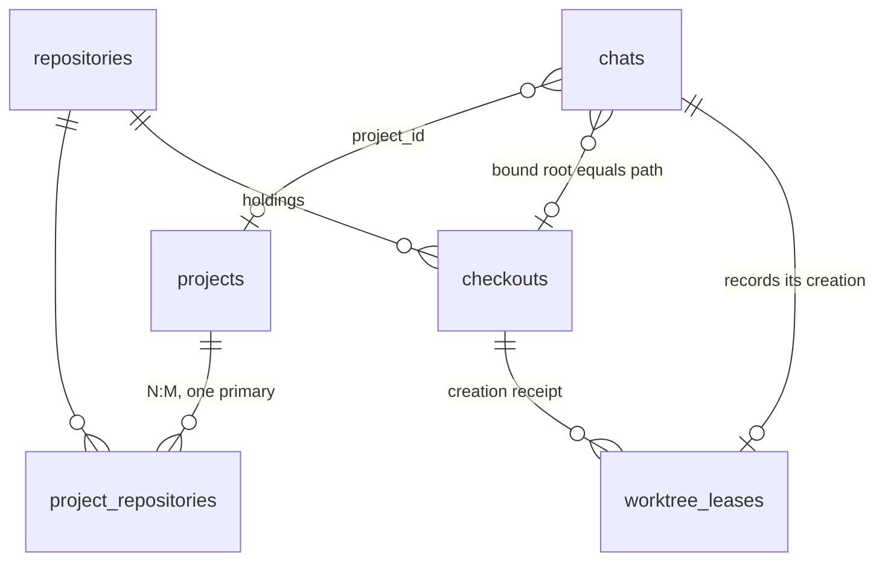

# Projects, repositories, checkouts, and machines

Noncanonical research for the project-location work. SPEC, OpenSpec, and shipped
code win any disagreement.

## Problem

llame today: a Project is a named, owner-only folder of Chats
(`apps/api/src/db/schema/projects.ts`). A Chat holds at most one Workspace
binding: one canonical root plus one executor id (`chats.workspace_root`,
`chats.workspace_executor_id`, local or `machine:<name>`), re-checked every
Run attempt and detached with one of six closed reasons. Machines register
allowed roots on the Machine itself; the hub records them in
`machines_status.roots`. Git is not modeled anywhere: no repository, checkout,
or worktree entity, and git runs only as opaque `bash`. There is no
`POST /chats`; a chat is created by its first message, unfiled, and the project
page composer is disabled behind `TODO(#1328)`.

Cases the model must cover:

- C1. One repository, several Projects: `llame development` and `llame testing`
  work on the same checkout for different purposes.
- C2. One Project, several repositories: SenseShift spans hardware, firmware,
  the app, and BLE-Serial.
- C3. Many × many: cardyo.
- C4. Per-machine divergence: each machine holds a different subset of
  repositories at different paths.

## Comparison

Columns: how the product identifies a repository; whether one repository can
back several projects (C1); whether one project can span several repositories
(C2); where "repo X lives at path P on machine M" is recorded (C4); worktree
deletion safety; what the agent sees.

| Product                                | Repo identity                                                                           | C1 one repo → N projects                                                                    | C2 one project → N repos                                                                                       | C4 per-machine path                                                                                                 | Worktree removal guard                                                                                       | Agent context                          |
| -------------------------------------- | --------------------------------------------------------------------------------------- | ------------------------------------------------------------------------------------------- | -------------------------------------------------------------------------------------------------------------- | ------------------------------------------------------------------------------------------------------------------- | ------------------------------------------------------------------------------------------------------------ | -------------------------------------- |
| Shipyard[^shipyard]                    | Project derived from remote slug `owner/repo`, else `name:<location>`; no DB            | No: same slug on two boxes merges into one project (manual split, per box only)             | No                                                                                                             | `locations.json` per box; laptop recomputes projects over all online boxes                                          | Git's own dirty refusal; main checkout guarded                                                               | One cwd, `BERTH_*` env                 |
| Orca[^orca]                            | Project id from remote (`github:o/r`, `git:host/path`); Repo = one checkout             | No: two same-remote clones on one host become one project with two setups, declared illegal | UI only (`ProjectGroup`, `FolderWorkspace`)                                                                    | `ProjectHostSetup` `${projectId}::${hostId}`                                                                        | Removal target required; durable `wt2:host:instance` id survives rename                                      | One cwd                                |
| Emdash[^emdash]                        | `(host, absolute path)`; same path on another host is distinct                          | No: `projects.repository_workspace_id` unique                                               | No (`project_remotes` are remotes of one checkout)                                                             | Host lives on the workspace row; host-truth `workspace_records` with `origin registered/adopted`, `observed_status` | Observed git state, tombstones                                                                               | One cwd                                |
| Superset[^superset]                    | Host DB: `repo_path`; cloud: clone URL, uniqueness dropped in 0037                      | Yes (cloud), by design                                                                      | Only `cloud_workspace_repositories` (sandboxes)                                                                | Host-local SQLite per machine; `projects setup <id>` clones elsewhere                                               | Inspect → warn `hasChanges`/`hasUnpushedCommits` → tombstone; refuses dirty; `rm -rf` fenced to managed root | One cwd                                |
| Jean[^jean]                            | Path string; `RepoIdentifier` derived from `origin` on demand, never stored             | Only as unrelated duplicate projects                                                        | `linked_project_ids` injected as prompt text                                                                   | None; client namespaces `serverId:resourceId`                                                                       | None: `remove --force` + `branch -D`                                                                         | One cwd + sibling root paths as text   |
| Synara[^synara]                        | Realpath of project root                                                                | No: second project on one path rejected                                                     | 1 primary + N additional folders, write-once; git actions primary-only; worktree mode refused for multi-folder | None; "Change project path…" repair                                                                                 | `remove` without force; branch deleted only if unchanged; orphan scan preserves unowned dirs                 | One cwd + `<project_folders>` preamble |
| Paseo[^paseo]                          | Root path per daemon; opaque `projectKey` (normalized remote) for cross-daemon grouping | No                                                                                          | No                                                                                                             | "Project host entry" per (project, daemon)                                                                          | `window.confirm` warning, deletes on accept                                                                  | One cwd                                |
| bb[^bb]                                | None; `projects.git_remote_url` optional                                                | Yes: two `project_sources` rows at the same (host, path)                                    | No per host: `project_sources` unique `(project, host)`                                                        | `project_sources(project, host, path)`; `environments(project, host, path)`                                         | None documented; force remove + teardown                                                                     | One cwd                                |
| Kandev[^kandev]                        | Workspace-scoped `Repository` row carrying `LocalPath` + `RemoteURL`                    | No: same repo in two workspaces = two rows                                                  | Yes: Task ↔ repos N:M (`TaskRepository`), `RepositorySet`                                                     | Paths derived `<base>/<task>/<repo>[-<slug>]` as siblings; remote via executor prepare script                       | Dirty-check all before delete, explicit discard, offline journaled `worktree-inventory-repair`               | Multiple sibling roots                 |
| Orchestrator.inc[^ao]                  | Project `Path` unique; `RepositoryIdentity` used only for PR attribution                | No                                                                                          | Yes: `workspace` kind with `workspace_repos` children                                                          | None                                                                                                                | `ErrWorkspaceDirty` + explicit `ForceDestroy`, preserve-ref stash                                            | Root dir with nested repos             |
| Coder[^coder]                          | None: repo is a template parameter string                                               | n/a                                                                                         | n/a                                                                                                            | Workspace is the machine; `coder_agent.dir`[^coder-agent]                                                           | n/a                                                                                                          | One dir                                |
| VS Code multi-root[^vscode-multi-root] | Folder paths; repos discovered beneath                                                  | Yes (same folder in many `.code-workspace`)                                                 | Yes                                                                                                            | One remote connection per window; folders open on that host[^vscode-remote]                                         | n/a                                                                                                          | Multi-root                             |
| `repo` manifest[^repo-tool]            | `name` → `${remote}/${name}.git`; `path` optional, machine-independent                  | n/a                                                                                         | Yes, with `groups`                                                                                             | `$TOP_DIR` + `.repo/`                                                                                               | n/a                                                                                                          | Tree of repos                          |
| `git worktree`[^git-worktree]          | `$GIT_DIR/worktrees/<id>` is the registry                                               | n/a                                                                                         | n/a                                                                                                            | Absolute `gitdir` pointers; `repair` after moves                                                                    | `remove` refuses dirty; `prune`, `lock`                                                                      | n/a                                    |

Observations:

- O1. No peer harness supports C1 and C2 together. Those that derive project
  identity from the remote (Shipyard[^shipyard], Orca[^orca], Paseo[^paseo]) get
  cross-machine grouping for free and lose C1. Those keyed by path
  (Emdash[^emdash], Jean[^jean], Synara[^synara], AO[^ao]) lose both rename
  tolerance and C1. Kandev[^kandev] and AO[^ao] are the only ones with a real
  multi-repo work unit, and both keep repository identity per workspace or per
  path.
- O2. Everyone that models machines does it as a `(thing, host, path)` row:
  Shipyard[^shipyard] `locations.json`, Orca[^orca] `ProjectHostSetup`,
  bb[^bb] `project_sources`, Superset[^superset] per-host DB. Nobody indexes
  that row by a stable repository key; the row is keyed by project or by path.
- O3. The reconciliation discipline that survives contact with users is
  "observe, mark, never auto-heal": Emdash[^emdash] `observed_status`,
  Kandev[^kandev]'s offline journaled repair, Synara[^synara]'s orphan scan that
  preserves unowned directories. Auto-deletion (Jean[^jean], bb[^bb],
  Paseo[^paseo]'s confirm-then-delete) is the cautionary tail.
- O4. The strongest removal guard is Superset[^superset] / Kandev[^kandev]:
  refuse when dirty or with unpushed commits, and tombstone instead of
  forgetting.
- O5. Every harness gives the agent one cwd. Multi-repo context is either a
  parent directory of sibling checkouts (Kandev[^kandev], AO[^ao]) or sibling
  paths as prompt text (Jean[^jean], Synara[^synara]).

## Ideation pass

Five isolated frames (relational modeler, Git plumbing, first-use design,
distributed-systems pessimist, FRBR cataloger) produced thirty ideas. Scores
are novelty / viability / fit, 0–10.

Cluster A — identity separate from location

- Repository as an authority record keyed by normalized remote, aliases for
  renames and forks; projects link ids, never URLs or paths. 6 / 9 / 9.
- Set-valued identity witnesses (root commit, normalized remote, bundle hash)
  with `UNIQUE(kind, value)`. 8 / 6 / 6. Trap: root commit is unavailable for
  shallow clones and identical across unrelated template-derived repos.
- Three tiers: `repositories` → `checkouts` (per machine) → `checkout_locations`
  with validity intervals. 6 / 7 / 7. Trap: interval table is more than C4 needs.
- Holdings table (machine × repository × path) with union-catalog availability
  computed at query time. 7 / 9 / 9.
- Hub-wide shared repository catalog with per-owner subscriptions. 5 / 5 / 3.
  Trap: a shared catalog of remote URLs is a cross-user disclosure path in an
  RLS-isolated product.

Cluster B — Git as registry

- `git worktree list --porcelain` is the worktree table; llame stores no
  worktree rows. 7 / 6 / 7. Trap: no ownership record, so two chats can take
  one tree and a lost tree is indistinguishable from a never-created one.
- Leases discovered from git, keyed by admin name and branch, expiring
  aggressively. 7 / 7 / 8.
- Associations as submodule gitlinks in a per-user manifest repo, or as refs in
  a bare registry repo. 9 / 3 / 3. Trap: a second authority beside Postgres,
  unreadable through RLS.
- `git config --local llame.project` written into checkouts, DB as cache.
  7 / 5 / 5. Trap: a checkout can serve several projects (C1), and the DB is
  the authority llame already has.
- Composite root: parent directory of per-repo worktrees for multi-repo
  projects, `.llame/repos` list. 6 / 7 / 8.

Cluster C — discovery and first use

- Executors scan registered roots for `.git`, report remotes, owner adopts.
  6 / 8 / 9.
- Projects materialize from usage, named after the remote. 7 / 6 / 5. Trap:
  contradicts C1, where two projects share one remote.
- New Chat is one text box with an editable "will start in … on …" chip.
  6 / 8 / 8.
- Chat opens unbound; first tool action binds it. 5 / 8 / 5. Trap: this is
  today's behavior and the thing being replaced.
- "Isolate in new worktree" toggle defaults on when another open chat already
  leases that checkout. 7 / 8 / 9.
- Offer card: "found 4 repos that look like SenseShift, treat as one project?"
  7 / 5 / 6.

Cluster D — failure posture

- Intent rows (user-authored) separate from observation rows (daemon-reported,
  TTL); read-time join assigns confidence. 7 / 7 / 8.
- Never store the path; derive it from (root, repo, project slug, slot).
  8 / 3 / 3. Trap: existing checkouts live wherever the owner put them.
- Binding as an ordered set of candidate locators, probe at chat start.
  6 / 6 / 6. Trap: duplicates the Machine availability narration.
- Association state machine proposed → observed → suspect → ghost → reaped
  only by user confirmation, with a drift inbox. 6 / 7 / 8.
- Circulation vocabulary: available / charged / on-hold / lost / withdrawn for
  checkouts; starting a chat is a charge. 7 / 8 / 8.
- Bind to (ref, resolved SHA) with "latest issue" versus "bound volume" modes.
  8 / 4 / 4. Trap: pinning SHAs is not how a coding chat works.

Shortlist: Repository authority + holdings (A), git-as-truth with lease
receipts and never-auto-heal (B + D), discovery with the editable chip and the
isolation default (C). Non-obvious viable pick: the circulation vocabulary,
because it names the C1 hazard directly: two projects on one checkout is fine
until two open chats charge the same item.

## Proposal

Keep the Chat Workspace binding exactly as shipped: one canonical root, one
executor, the existing re-check and detach. Add three owner-scoped entities
above it and one receipt beside it. Projects store no paths.

`openspec/specs/repositories` and `openspec/changes/chat-start-location` are
canonical for this model.



- `repositories(id, owner_user_id, display_name, canonical_remote)`, unique
  `(owner_user_id, canonical_remote)`. `canonical_remote` is a pure
  normalization: scheme and credentials stripped, host lowercased, `.git` and
  trailing slash removed, so `git@github.com:leon0399/llame.git` and
  `https://github.com/leon0399/llame` are one row. `repository_aliases` holds
  prior spellings with the same uniqueness, for renames and forks the owner
  declares equal. A remote-less repository is allowed with `canonical_remote`
  null and identity by its first checkout. Owner-scoped under RLS, not a shared
  catalog (Cluster A trap). A display name is one path segment without `/` or
  NUL, and never `.` or `..`.
- `checkouts(id, owner_user_id, repository_id, executor_id, path, kind,
parent_checkout_id, branch, origin, worktree_base)`: a holding. `executor_id`
  uses the existing grammar (local executor id or `machine:<name>`); `path` is
  the canonical absolute path on that executor, or the canonical
  `machine://<name>/<path>` locator, which compares equal to a bound root;
  unique `(owner_user_id, executor_id, path)`, because every owner shares the
  local executor and every Machine. `kind` is `main` or `worktree`; a worktree
  row names its source clone in `parent_checkout_id`, on the same executor, so
  main clones and their worktrees form one inventory tree and a chat always
  binds a checkout row (Emdash `kind repository|worktree` + `parent_id`
  pattern[^emdash]). `branch` is nullable, because a registered or adopted row
  can sit on a detached HEAD, and a worktree llame creates always has one.
  `origin` is `registered`, `adopted`, or `created` (by llame). `worktree_base`
  is set on `main` rows only and its value MUST use that row's executor. There
  is no `observed_status` column and no foreign key to `machines_status`, which
  the hub probe rewrites. A missing Machine leaves the row inert, the same way
  an unreachable Machine leaves a binding in place today. This answers C4
  without a per-project matrix, and C1 by letting two projects reference one
  repository whose single checkout exists once.
- `project_repositories(owner_user_id, project_id, repository_id, alias,
is_primary, isolation)`, unique `(owner_user_id, project_id, repository_id)`,
  partial unique on `(owner_user_id, project_id) WHERE is_primary`.
  `isolation` is `inherit`, `always_worktree`, or `never`. `alias` is the
  project-local name the UI uses (`firmware`, `app`). This is C2 and C3. The
  project also gains `default_executor_id` nullable.
- `project_repository_defaults(owner_user_id, project_repository_id,
executor_id, checkout_id)`, unique `(owner_user_id, project_repository_id,
executor_id)`. `checkout_id` MUST name a `main` checkout of that repository on
  that executor. The row is written from the last successful chat start.
- `worktree_leases(id, owner_user_id, chat_id, checkout_id, base_ref,
base_commit, created_at)`: an informational ownership receipt, written when a
  chat creates a worktree. It records the owner, the chat, the worktree
  checkout, the base ref, the base commit that the add reported, and the
  creation time. It reserves nothing and refuses nothing: a second chat can
  bind a leased path, and the UI reads "also bound by chat X" from the lease
  and the bound roots. Leases cascade with their checkout.

### Chat creation

Chat creation is one request, `POST /api/v1/chats`, carrying the first message
and the location together. `openspec/specs/repositories` owns the repository,
checkout, lease, and worktree rules; `openspec/changes/chat-start-location`
owns this flow.

```text
{ id (client uuid), projectId?, repositoryId?, executorId?, checkoutId?,
  worktree?: { name?, baseRef? },
  message?: { id, parts, modelId, effort?, permissionMode? } }
```

1. Validate with no write. When `message` is present, the server validates the
   model, the effort, the permission mode, the parts, and the media ownership
   as the message route does; a `bypass` mode this process does not enable
   answers 422. A `worktree.name` or `baseRef` that fails the input rules
   answers 422. Any failure stores nothing.
2. Take the per-chat session advisory lock on the chat id. A concurrent create
   with the same id answers 409 `creation_in_progress` and changes nothing.
3. Validate the named ids and insert the chat row, filed with its project, in
   one transaction. A foreign or missing id answers 404, an archived project
   409, and an executor that no configuration carries answers 422
   `executor_unknown`. A named `checkoutId` fixes its repository and executor
   and MUST be a `main` row. An explicit id always overrides a remembered
   default.
4. Resolve the location. Repository: the request, else the primary link, else
   the single link, else none. Executor: the request, else the link's
   remembered default, else `projects.default_executor_id`, else the only
   executor that holds a `main` checkout, else the online executor with the
   lowest id that holds a main checkout of that repository. Checkout: the
   request, else the remembered default for the link and executor, else the
   only `main` checkout on that executor, else none. Implicit steps skip an
   offline Machine; an explicit id or a remembered default that names one
   answers `machine_unavailable`. A project with several linked repositories
   and no primary resolves to none, and the server never picks one: the chat
   is created unbound.
5. Authorize through the `enter_workspace` decision function as a server-owned
   action: the submitted checkout path before any probe, the canonical source
   clone before any git call, the inspected main tree after the read-only
   `git.inspect`, and the canonical worktree directory before the add. The mode
   is the message's permission mode, `default` when omitted. There is no tool
   call, no model choice, and no Run.
6. Create the worktree when requested, through the `repositories` rules, with
   the registered `main` checkout as the source. The worktree checkout row, its
   lease, and the bound root commit in one transaction.
7. Store the bound root as `workspace_root`, `workspace_executor_id`, and
   `workspace_generation + 1`, then store the message and its Run row, which
   commit together, and enqueue after that commit. Record the defaults as the
   source `main` checkout; a worktree start records its source, not the new
   worktree.

A failure in authorization, worktree creation, or binding leaves the chat filed
and unbound. The response carries one `workspace` status from a closed set:
`bound`, `unbound`, `bind_failed`, `worktree_failed`, `machine_unavailable`,
`machine_update_required`, `outcome_unknown`.

Multi-repo context: the agent keeps one cwd. Sibling checkouts are reachable by
absolute path or `..`, and permissions still evaluate the projected absolute
path. A rail item that lists a project's other repositories, and a composite
parent root, are deferred non-goals (change 1, D7).

## Lifecycle

- Removal is explicit and owner-initiated, through
  `DELETE /api/v1/checkouts/:id/worktree`. It refuses when `git status` reports
  uncommitted changes or commits that are not pushed. It fails closed when the
  upstream branch is unknown, unless the worktree HEAD equals the base commit
  recorded in its creation lease; a worktree with no lease keeps the
  fail-closed rule, because no recorded base commit proves the branch is
  unchanged. Then `git worktree remove` runs, and only after it succeeds do the
  row and its lease disappear. `git worktree remove` keeps the `llame/<name>`
  branch, so a clean removal loses no commit. No Run can remove a worktree.
- Deletion cascades rows and never files. Deleting a repository drops its
  `main` and `worktree` checkout rows and their leases; deleting a `main`
  checkout drops its worktree rows; a project delete cascades
  `project_repositories` and their defaults only. Directories stay on disk, a
  chat keeps its stored path string, and it detaches only through the existing
  per-attempt re-check.
- Forks (`owner-chat-forks`) copy the Workspace binding today. Leases are
  informational, so a fork writes no new lease, even when the source root is
  leased.
- Deferred non-goals (change 1, D7), which are not planned behavior: the
  inventory sweep and `observed_status`, the discovery scan
  (`inventory.scan`), agent-initiated removal, a Machine announcement of
  repositories to the model, a project rail item, and a composite parent root
  for multi-repo projects.

## Safeguards and negative tests

`repositories`, `checkouts`, `project_repositories`, and `worktree_leases`
carry `FORCE RLS` owner policies like `projects`; a foreign `repositoryId` or
`checkoutId` fails as the foreign `projectId` fails today (42501 → 404), and
every child row uses a composite owner foreign key, because an FK check
bypasses RLS. Checkout paths are owner-private host paths and appear only in
owner-only responses, the exception `model-system-prompts` already grants for
the canonical root.

Git input reaches the executor through these rules, each owned by a requirement
of change 1:

- Names cannot be a path or an option: no leading `-`, no `.` or `..` segment,
  and the git branch-name rules apply ("Worktree names, branches, and base refs
  follow one rule"). The slug replaces `/` with `-`, and the branch is
  `llame/<name>`, or `name` itself when it holds a `/`.
- A `baseRef` that starts with `-` is rejected before git starts. Every other
  caller value follows `--end-of-options` or `--` where the subcommand accepts
  one, and every path is absolute ("Git calls refuse option-like caller
  values").
- Executors expose typed git operations only: `git.inspect`,
  `git.worktreeAdd`, `git.worktreeList`, `git.worktreeRemove`, and `git.status`
  take typed input, pass an argument vector, and never a shell string, so no
  caller text becomes a command line ("Executors expose typed git operations").
  Calls also run with an empty hooks path, `core.fsmonitor=false`,
  `GIT_TERMINAL_PROMPT=0`, and a timeout ("Git calls cannot run repository
  hooks or monitors").
- The worktree directory is decided on the canonical form of its
  deepest-existing ancestor, beside the source clone or under its
  `worktree_base` ("Worktree placement follows the source clone and its
  worktree base"). On a Machine it must lie inside a registered root before
  `git.worktreeAdd`, decided by the daemon and not by the hub's cached roots
  ("Worktree directories on a Machine lie inside a registered root").
- After the add, the real path of the new directory must equal the decided
  path; a difference removes the worktree and fails `worktree_failed`
  ("Worktree creation verifies the decided path").
- There is no separate "valid Git ref" check. Git resolves the ref itself, and
  a failure comes back as `worktree_failed` with the git standard error.

## Where the checkout path lives

Two candidate placements for "repo R is at path P on machine M":

- On the project↔repository link (`project_repositories.path`, per machine).
  Lets `llame testing` use a different clone than `llame development`, but
  duplicates the same path across every project that shares a repository (C1),
  makes a moved checkout an N-row update, and hides from the inventory that two
  projects write one tree.
- On the repository (`checkouts`, proposed above). The path is a fact about the
  machine, recorded once. A project-specific preference is a small defaults
  table, `project_repository_defaults`, written from the last successful chat
  start and read as the chat-start default. Both cases in C1 work: shared clone
  (both projects default to the same checkout) and separate clones (each
  project defaults to its own).

The second placement is chosen: `checkouts` carries the path, and the defaults
row carries the per-project preference.

## Chat start parameters and UX

Every location fact is an initial parameter of the chat and a resolved default
at the same time. The composer never blocks on them; it shows the resolution
as one editable chip and opens a cascade only on demand.

| Parameter                      | Default source                                                                                                                    | Shown when                                                                                                                                  |
| ------------------------------ | --------------------------------------------------------------------------------------------------------------------------------- | ------------------------------------------------------------------------------------------------------------------------------------------- |
| Project                        | Page context (project page, chat in project), else none                                                                           | Always as the chip's first segment; empty chip = unfiled, unbound                                                                           |
| Repository                     | Primary link, else the single link, else none                                                                                     | Project has more than one repository                                                                                                        |
| Machine / executor             | `project_repository_defaults` for this repo; project `default_executor_id`; the only holder; the online holder with the lowest id | More than one executor holds a checkout; offline executors listed disabled with the reason                                                  |
| Source checkout                | Defaults row; the only `main` checkout on that executor                                                                           | More than one main clone of the repo on that executor. The bound root is this path when reusing, and the new worktree's path when isolating |
| Isolation                      | Reuse the source checkout; switches to "new worktree" when another open chat already binds it                                     | Always inside the cascade; the chip then shows the worktree path, and the source clone appears only in the popover                          |
| Worktree base ref              | Source checkout's HEAD                                                                                                            | Isolation on                                                                                                                                |
| Worktree name                  | Generated `<adjective>-<noun>-<4 hex>`; owner may type a name; branch `llame/<name>`                                              | Isolation on                                                                                                                                |
| Model, effort, permission mode | Existing controls                                                                                                                 | Unchanged                                                                                                                                   |

Flow:

1. Composer opens with the chip resolved from context, for example
   `llame development · llame · nas · ~/src/llame (master)`. A missing default
   that the cascade cannot resolve renders the chip in a warning state naming
   the missing step; sending still works and creates the chat filed and
   unbound.
2. Clicking the chip opens one popover with the cascade as stacked selects.
   Changing an upper level recomputes the levels below from their defaults.
   A "register checkout…" affordance at the checkout level takes a path on
   the chosen executor and creates the holding inline.
3. Sending calls `POST /api/v1/chats` with the resolved ids and the first
   message. The server re-resolves defaults, binds, and creates the worktree
   when requested. It refuses with a field error rather than guessing when the
   selection is stale (an unknown checkout, an offline executor). A path that
   another open chat already binds still works; isolation is the opt-in, not a
   refusal.
4. The chat header shows the same chip read-only with the bound root; the
   existing `enter_workspace`/`exit_workspace` and `PATCH projectId` remain
   the ways to change it afterwards.

Entry points that pre-fill the chip: project page composer (project), sidebar
"New chat in project", "New chat here" on an existing chat (copies project,
repository, executor, and checkout; isolation defaults to a new worktree
because the source chat binds that checkout), a worktree row in the project's
inventory (opens that worktree), and a deep link
`/chat/new?project=&repository=&executor=&checkout=&worktree=1`.

Remembering choices: the last successful selection per (project repository,
executor) writes `project_repository_defaults`, so the second chat in a project
needs zero clicks.

Offline Machine: `enter_workspace` needs the daemon to canonicalize the path, so
an offline executor cannot be bound at creation. Its option is disabled with
"offline"; the owner picks another or sends unbound and enters later.

Worktree naming: the title does not exist at creation, and renaming a branch
after the first turn adds a rename path for little value. Change 1 generates
`<adjective>-<noun>-<4 hex>` unless the owner types a name, and the branch is
`llame/<name>`.

## Canonical changes

- `openspec/specs/repositories`: the repository and checkout catalog under
  owner RLS, canonical remote and aliases, registration through typed executor
  git methods, the `enter_workspace` worktree option with its four decisions,
  the lease receipt, and the guarded owner removal. This capability shipped
  its proposal as `openspec/changes/archive/2026-10-24-repositories`.
- `openspec/changes/chat-start-location`: the project↔repository link with an
  alias, one primary, and an isolation policy; per-executor defaults; project
  `default_executor_id`; `POST /api/v1/chats` that resolves, authorizes, and
  binds before the first Run; the composer chip and cascade.

## Decisions

- OD1. Repository identity by normalized remote plus declared aliases
  (proposed) versus adding a root-commit witness. Outcome: remote plus aliases.
- OD2. Multi-repo context as sibling absolute paths (proposed) versus a
  composite parent root of worktrees. Outcome: deferred with the announcement
  work; sibling paths remain reachable through `..`.
- OD3. Worktree location: a per-checkout `worktree_base` defaulting to a
  sibling of the checkout, `.llame-worktrees/<display name>/<slug>` beside the
  source clone, versus a per-executor base. On a Machine the base must lie
  inside a registered root. Outcome: sibling default with a per-checkout
  override.
- OD4. Fork of a leased chat: new worktree from the same base, or unbound.
  Outcome: leases are informational; a fork copies the binding and writes no
  lease.
- OD5. Whether `llame testing` chats default to a worktree. Outcome: an
  isolation policy on the project-repository link with `inherit`,
  `always_worktree`, and `never`; the per-chat choice is final.

[^shipyard]: [Shipyard locations, project key, and project groups](https://github.com/cosscom/shipyard/tree/b140a0ffe8cd44ba4d410f3f100d1cc34acb6790)

[^orca]: [Orca worktree, project-host setup, and remote identity sources](https://github.com/stablyai/orca/tree/d9cf07d3f4a3b2bc114a745ef39ff6a0585fcfef)

[^emdash]: [Emdash workspace records and the workspace registry](https://github.com/generalaction/emdash/tree/761520624f1cafa740f5c88ddaf083b4fde2cc59)

[^superset]: [Superset host-service and cloud database schemas](https://github.com/superset-sh/superset/tree/575bd21377f2716ca5db67dc3f1b9244a63c20d9)

[^jean]: [Jean project types, git commands, and server resources](https://github.com/coollabsio/jean/tree/b766f894c9f66405681161cfda4c4f85473b4204)

[^synara]: [Synara core concepts and persistence migrations](https://github.com/Emanuele-web04/synara/tree/df87a48b9f2d403e3d2785ef11502f2ce2922f5b)

[^bb]: [bb schema, worktrees, and multiple devices](https://github.com/get-bb/bb/tree/fd31b75fb9c7f40e68747089c911b098763aa851)

[^kandev]: [Kandev repository, task, and task-environment models](https://github.com/kdlbs/kandev/tree/b35ac5170fb57d8a27864ca5d09c04271bf0fb94)

[^paseo]: [Paseo project and workspace registry](https://github.com/getpaseo/paseo/tree/a4eb0adcf62b643a7b817743f7a6fa752f4068af)

[^ao]: [Orchestrator.inc project kinds, workspace repositories, and session worktrees](https://github.com/OrchestratorInc/agent-orchestrator/tree/edf0bfaacbf63f3df693dcb88f72e9a1d7168480)

[^coder]: [Coder template parameters, including a repository URL](https://github.com/coder/coder/blob/v2.37.6/docs/admin/templates/extending-templates/parameters.md)

[^coder-agent]: [Coder workspace agent and its working directory](https://github.com/coder/coder/blob/v2.37.6/docs/admin/templates/extending-templates/index.md)

[^vscode-multi-root]: [VS Code multi-root workspaces](https://github.com/microsoft/vscode-docs/blob/7f0009b18ff2e915d9c286b1af09666c46be8c02/docs/editing/workspaces/multi-root-workspaces.md)

[^vscode-remote]: [VS Code Remote Development opens folders on a remote machine](https://github.com/microsoft/vscode-docs/blob/7f0009b18ff2e915d9c286b1af09666c46be8c02/docs/remote/remote-overview.md)

[^repo-tool]: [repo manifest format: project name, path, and groups](https://gerrit.googlesource.com/git-repo/+/46e9866ca0f161604bd45a0c3b7c7887c9415dcb/docs/manifest-format.md)

[^git-worktree]: [git worktree: the $GIT_DIR/worktrees registry, prune, lock, repair, and a clean-only remove](https://git-scm.com/docs/git-worktree/2.48.0)
