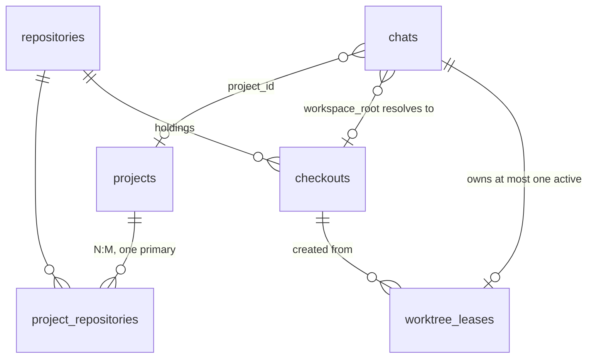

# Projects, repositories, checkouts, and machines

Noncanonical research for the project-location work selected on 2026-10-23
(after `remote-machines` shipped). Per-harness detail lives in the scout
reports that fed this document; this file keeps the comparison and the
proposal. SPEC, OpenSpec, and shipped code win any disagreement.

## Problem

llame today: a Project is a named, owner-only folder of Chats
(`apps/api/src/db/schema/projects.ts`). A Chat holds at most one Workspace
binding: one canonical root plus one executor id (`chats.workspace_root`,
`chats.workspace_executor_id`, local or `machine:<name>`), re-checked every
Run attempt and detached with one of six closed reasons. Machines register
allowed roots on the Machine itself; the hub records them in
`machines_status.roots`. Git is not modeled anywhere: no repository, checkout,
or worktree entity, and git runs only as opaque `bash`. There is no
`POST /chats`; a chat is created by its first message, unfiled, and the project
page composer is disabled behind `TODO(#1328)`.

Cases the model must cover:

- C1. One repository, several Projects: `llame development` and `llame testing`
  work on the same checkout for different purposes.
- C2. One Project, several repositories: SenseShift spans hardware, firmware,
  the app, and BLE-Serial.
- C3. Many × many: cardyo.
- C4. Per-machine divergence: each machine holds a different subset of
  repositories at different paths.

## Comparison

Columns: how the product identifies a repository; whether one repository can
back several projects (C1); whether one project can span several repositories
(C2); where "repo X lives at path P on machine M" is recorded (C4); worktree
deletion safety; what the agent sees.

| Product            | Repo identity                                                                           | C1 one repo → N projects                                                                    | C2 one project → N repos                                                                                       | C4 per-machine path                                                                                                 | Worktree removal guard                                                                                       | Agent context                          |
| ------------------ | --------------------------------------------------------------------------------------- | ------------------------------------------------------------------------------------------- | -------------------------------------------------------------------------------------------------------------- | ------------------------------------------------------------------------------------------------------------------- | ------------------------------------------------------------------------------------------------------------ | -------------------------------------- |
| Shipyard           | Project derived from remote slug `owner/repo`, else `name:<location>`; no DB            | No: same slug on two boxes merges into one project (manual split, per box only)             | No                                                                                                             | `locations.json` per box; laptop recomputes projects over all online boxes                                          | Git's own dirty refusal; main checkout guarded                                                               | One cwd, `BERTH_*` env                 |
| Orca               | Project id from remote (`github:o/r`, `git:host/path`); Repo = one checkout             | No: two same-remote clones on one host become one project with two setups, declared illegal | UI only (`ProjectGroup`, `FolderWorkspace`)                                                                    | `ProjectHostSetup` `${projectId}::${hostId}`                                                                        | Removal target required; durable `wt2:host:instance` id survives rename                                      | One cwd                                |
| Emdash             | `(host, absolute path)`; same path on another host is distinct                          | No: `projects.repository_workspace_id` unique                                               | No (`project_remotes` are remotes of one checkout)                                                             | Host lives on the workspace row; host-truth `workspace_records` with `origin registered/adopted`, `observed_status` | Observed git state, tombstones                                                                               | One cwd                                |
| Superset           | Host DB: `repo_path`; cloud: clone URL, uniqueness dropped in 0037                      | Yes (cloud), by design                                                                      | Only `cloud_workspace_repositories` (sandboxes)                                                                | Host-local SQLite per machine; `projects setup <id>` clones elsewhere                                               | Inspect → warn `hasChanges`/`hasUnpushedCommits` → tombstone; refuses dirty; `rm -rf` fenced to managed root | One cwd                                |
| Jean               | Path string; `RepoIdentifier` derived from `origin` on demand, never stored             | Only as unrelated duplicate projects                                                        | `linked_project_ids` injected as prompt text                                                                   | None; client namespaces `serverId:resourceId`                                                                       | None: `remove --force` + `branch -D`                                                                         | One cwd + sibling root paths as text   |
| Synara             | Realpath of project root                                                                | No: second project on one path rejected                                                     | 1 primary + N additional folders, write-once; git actions primary-only; worktree mode refused for multi-folder | None; "Change project path…" repair                                                                                 | `remove` without force; branch deleted only if unchanged; orphan scan preserves unowned dirs                 | One cwd + `<project_folders>` preamble |
| Paseo              | Root path per daemon; opaque `projectKey` (normalized remote) for cross-daemon grouping | No                                                                                          | No                                                                                                             | "Project host entry" per (project, daemon)                                                                          | `window.confirm` warning, deletes on accept                                                                  | One cwd                                |
| bb                 | None; `projects.git_remote_url` optional                                                | Yes: two `project_sources` rows at the same (host, path)                                    | No per host: `project_sources` unique `(project, host)`                                                        | `project_sources(project, host, path)`; `environments(project, host, path)`                                         | None documented; force remove + teardown                                                                     | One cwd                                |
| Kandev             | Workspace-scoped `Repository` row carrying `LocalPath` + `RemoteURL`                    | No: same repo in two workspaces = two rows                                                  | Yes: Task ↔ repos N:M (`TaskRepository`), `RepositorySet`                                                     | Paths derived `<base>/<task>/<repo>[-<slug>]` as siblings; remote via executor prepare script                       | Dirty-check all before delete, explicit discard, offline journaled `worktree-inventory-repair`               | Multiple sibling roots                 |
| Orchestrator.inc   | Project `Path` unique; `RepositoryIdentity` used only for PR attribution                | No                                                                                          | Yes: `workspace` kind with `workspace_repos` children                                                          | None                                                                                                                | `ErrWorkspaceDirty` + explicit `ForceDestroy`, preserve-ref stash                                            | Root dir with nested repos             |
| Coder              | None: repo is a template parameter string                                               | n/a                                                                                         | n/a                                                                                                            | Workspace is the machine; `coder_agent.dir`                                                                         | n/a                                                                                                          | One dir                                |
| VS Code multi-root | Folder paths; repos discovered beneath                                                  | Yes (same folder in many `.code-workspace`)                                                 | Yes                                                                                                            | Window's remote authority                                                                                           | n/a                                                                                                          | Multi-root                             |
| `repo` manifest    | `name` → `${remote}/${name}.git`; `path` optional, machine-independent                  | n/a                                                                                         | Yes, with `groups`                                                                                             | `$TOP_DIR` + `.repo/`                                                                                               | n/a                                                                                                          | Tree of repos                          |
| `git worktree`     | `$GIT_DIR/worktrees/<id>` is the registry                                               | n/a                                                                                         | n/a                                                                                                            | Absolute `gitdir` pointers; `repair` after moves                                                                    | `remove` refuses dirty; `prune`, `lock`                                                                      | n/a                                    |

Observations:

- O1. No peer harness supports C1 and C2 together. Those that derive project
  identity from the remote (Shipyard, Orca, Paseo) get cross-machine grouping
  for free and lose C1. Those keyed by path (Emdash, Jean, Synara, AO) lose
  both rename tolerance and C1. Kandev and AO are the only ones with a real
  multi-repo work unit, and both keep repository identity per workspace or
  per path.
- O2. Everyone that models machines does it as a `(thing, host, path)` row:
  Shipyard `locations.json`, Orca `ProjectHostSetup`, bb `project_sources`,
  Superset per-host DB. Nobody indexes that row by a stable repository key;
  the row is keyed by project or by path.
- O3. The reconciliation discipline that survives contact with users is
  "observe, mark, never auto-heal": Emdash `observed_status`, Kandev's offline
  journaled repair, Synara's orphan scan that preserves unowned directories.
  Auto-deletion (Jean, bb, Paseo's confirm-then-delete) is the cautionary tail.
- O4. The strongest removal guard is Superset/Kandev: refuse when dirty or with
  unpushed commits, and tombstone instead of forgetting.
- O5. Every harness gives the agent one cwd. Multi-repo context is either a
  parent directory of sibling checkouts (Kandev, AO) or sibling paths as prompt
  text (Jean, Synara).

## Ideation pass

Five isolated frames (relational modeler, Git plumbing, first-use design,
distributed-systems pessimist, FRBR cataloger) produced thirty ideas. Scores
are novelty / viability / fit, 0–10.

Cluster A — identity separate from location

- Repository as an authority record keyed by normalized remote, aliases for
  renames and forks; projects link ids, never URLs or paths. 6 / 9 / 9.
- Set-valued identity witnesses (root commit, normalized remote, bundle hash)
  with `UNIQUE(kind, value)`. 8 / 6 / 6. Trap: root commit is unavailable for
  shallow clones and identical across unrelated template-derived repos.
- Three tiers: `repositories` → `checkouts` (per machine) → `checkout_locations`
  with validity intervals. 6 / 7 / 7. Trap: interval table is more than C4 needs.
- Holdings table (machine × repository × path) with union-catalog availability
  computed at query time. 7 / 9 / 9.
- Hub-wide shared repository catalog with per-owner subscriptions. 5 / 5 / 3.
  Trap: a shared catalog of remote URLs is a cross-user disclosure path in an
  RLS-isolated product.

Cluster B — Git as registry

- `git worktree list --porcelain` is the worktree table; llame stores no
  worktree rows. 7 / 6 / 7. Trap: no ownership record, so two chats can take
  one tree and a lost tree is indistinguishable from a never-created one.
- Leases discovered from git, keyed by admin name and branch, expiring
  aggressively. 7 / 7 / 8.
- Associations as submodule gitlinks in a per-user manifest repo, or as refs in
  a bare registry repo. 9 / 3 / 3. Trap: a second authority beside Postgres,
  unreadable through RLS.
- `git config --local llame.project` written into checkouts, DB as cache.
  7 / 5 / 5. Trap: a checkout can serve several projects (C1), and the DB is
  the authority llame already has.
- Composite root: parent directory of per-repo worktrees for multi-repo
  projects, `.llame/repos` list. 6 / 7 / 8.

Cluster C — discovery and first use

- Executors scan registered roots for `.git`, report remotes, owner adopts.
  6 / 8 / 9.
- Projects materialize from usage, named after the remote. 7 / 6 / 5. Trap:
  contradicts C1, where two projects share one remote.
- New Chat is one text box with an editable "will start in … on …" chip.
  6 / 8 / 8.
- Chat opens unbound; first tool action binds it. 5 / 8 / 5. Trap: this is
  today's behavior and the thing being replaced.
- "Isolate in new worktree" toggle defaults on when another open chat already
  leases that checkout. 7 / 8 / 9.
- Offer card: "found 4 repos that look like SenseShift, treat as one project?"
  7 / 5 / 6.

Cluster D — failure posture

- Intent rows (user-authored) separate from observation rows (daemon-reported,
  TTL); read-time join assigns confidence. 7 / 7 / 8.
- Never store the path; derive it from (root, repo, project slug, slot).
  8 / 3 / 3. Trap: existing checkouts live wherever the owner put them.
- Binding as an ordered set of candidate locators, probe at chat start.
  6 / 6 / 6. Trap: duplicates the Machine availability narration.
- Association state machine proposed → observed → suspect → ghost → reaped
  only by user confirmation, with a drift inbox. 6 / 7 / 8.
- Circulation vocabulary: available / charged / on-hold / lost / withdrawn for
  checkouts; starting a chat is a charge. 7 / 8 / 8.
- Bind to (ref, resolved SHA) with "latest issue" versus "bound volume" modes.
  8 / 4 / 4. Trap: pinning SHAs is not how a coding chat works.

Shortlist: Repository authority + holdings (A), git-as-truth with lease
receipts and never-auto-heal (B + D), discovery with the editable chip and the
isolation default (C). Non-obvious viable pick: the circulation vocabulary,
because it names the C1 hazard directly: two projects on one checkout is fine
until two open chats charge the same item.

## Proposal

Keep the Chat Workspace binding exactly as shipped: one canonical root, one
executor, the existing re-check and detach. Add three owner-scoped entities
above it and one receipt beside it. Projects store no paths.

- `repositories(id, owner_user_id, display_name, canonical_remote)`, unique
  `(owner_user_id, canonical_remote)`. `canonical_remote` is a pure
  normalization: scheme and credentials stripped, host lowercased, `.git` and
  trailing slash removed, so `git@github.com:leon0399/llame.git` and
  `https://github.com/leon0399/llame` are one row. `repository_aliases` holds
  prior spellings with the same uniqueness, for renames and forks the owner
  declares equal. A remote-less repository is allowed with `canonical_remote`
  null and identity by its first checkout. Owner-scoped under RLS, not a shared
  catalog (Cluster A trap).
- `checkouts(id, owner_user_id, repository_id, executor_id, path, kind,
parent_checkout_id, branch, origin, observed_status, observed_at)`: a
  holding. `executor_id` uses the existing grammar (local executor id or
  `machine:<name>`); `path` is the canonical absolute path on that executor;
  unique `(executor_id, path)`. `kind` is `main` or `worktree`; a worktree
  row names its source clone in `parent_checkout_id`, so main clones and their
  worktrees form one inventory tree and a chat always binds a checkout row
  (Emdash `kind repository|worktree` + `parent_id`). `origin` is `registered`,
  `discovered`, or `created` (by llame); `observed_status` is `present`,
  `missing`, or `moved`. No foreign key to `machines_status`, which the hub
  probe rewrites. A missing Machine leaves the row inert, the same way an
  unreachable Machine leaves a binding in place today. This answers C4 without
  a per-project matrix, and C1 by letting two projects reference one
  repository whose single checkout exists once.
- `project_repositories(project_id, repository_id, alias, is_primary)`, unique
  `(project_id, repository_id)`, partial unique on `(project_id) WHERE
is_primary`. `alias` is the project-local name the UI and the `workspace`
  rail item use (`firmware`, `app`). This is C2 and C3. The project also gains
  `default_executor_id` nullable.
- `worktree_leases(id, owner_user_id, chat_id, checkout_id, base_ref, state,
created_at, released_at)`, `checkout_id` a `worktree` row, partial unique on
  `(checkout_id)` where `state = 'active'`; the branch uniqueness per executor
  lives on `checkouts.branch` for worktree rows. States: `active`, `released`,
  `lost`. Git remains the registry of which worktrees exist; the lease is an
  ownership receipt. The circulation rule: a chat may bind a worktree checkout
  only if it owns the lease. `project_repository_defaults` points at `main`
  rows only, since a worktree is per chat.

Resolution at chat creation, `POST /api/v1/chats` with
`{ projectId, repositoryId?, executorId?, worktree?: { baseRef? } }`:

1. Repository defaults to the project's primary; required when the project has
   several and none is primary.
2. Executor defaults to the project's `default_executor_id`, else the only
   executor holding a checkout, else the first online one (Shipyard's rule).
3. Without `worktree`, the chat binds the checkout's path through the existing
   `enter_workspace` path (submitted and canonical permission decisions, the
   `execute_code` classification, generation fence) as a trusted server-side
   action, not a model call. With `worktree`, the executor runs
   `git worktree add -b llame/<slug> <base>/<repo>/<slug> <baseRef>` inside
   the checkout, the lease is inserted after success, and the chat binds the new
   path. A failure between `worktree add` and the insert leaves a directory the
   sweep reports and never deletes.
4. The chat is created filed and bound in one transaction, which also closes
   #1328.

Multi-repo context: the `workspace` rail item lists the project's other
repositories with their absolute paths on the bound executor when a checkout
exists there, and names those absent on it. The agent keeps one cwd; sibling
paths are reachable because `..` already leaves the root, and permissions still
evaluate the projected absolute path. A composite parent root (Cluster B) is a
later slice if sibling paths prove insufficient.

Lifecycle:

- Removal is explicit, owner-initiated, refuses when `git status --porcelain`
  is non-empty or `git log @{u}..HEAD` is non-empty, fails closed when the
  upstream is unknown, and sets `released`. Chat archive and deletion never
  cascade into a worktree. `project` deletion cascades only
  `project_repositories`.
- A sweep (on bind, on explicit refresh, and slowly in the background) compares
  leases and checkouts against `git worktree list --porcelain` and `realpath`
  on the executor, marks `lost`/`missing`/`moved`, and never re-adds, prunes,
  or rebinds. The Chat's own re-check still detaches with the existing reasons;
  the sweep only updates the inventory the UI shows.
- Forks (`owner-chat-forks`) copy the Workspace binding today. A fork of a
  chat whose root is leased must either take a new worktree from the same
  base or be created unbound; it never shares the lease. This is a spec change
  to `owner-chat-forks`.
- Discovery: a bounded `inventory.scan` on the local executor and the Machine
  daemon (registered roots only, bounded depth, no symlink following, reads
  `.git` and remotes, writes nothing) upserts `discovered` checkouts and
  proposes repositories by `canonical_remote`. A discovered row never binds a
  chat until adopted, so the scan is advisory. Hub-only first.

Threats and negative tests: `repositories`, `checkouts`, `project_repositories`,
and `worktree_leases` carry `FORCE RLS` owner policies like `projects`; a
foreign `repositoryId` or `checkoutId` fails as the foreign `projectId` fails
today (42501 → 404). Checkout paths are owner-private host paths and appear
only in owner-only responses and the owner-only `workspace` rail item, the
exception `model-system-prompts` already grants for the canonical root. The
worktree `add`/`remove` run under the `bash` executor identity with the
server's own argument construction; no model-authored string reaches them.

## Where the checkout path lives

Two candidate placements for "repo R is at path P on machine M":

- On the project↔repository link (`project_repositories.path`, per machine).
  Lets `llame testing` use a different clone than `llame development`, but
  duplicates the same path across every project that shares a repository
  (C1), makes a moved checkout an N-row update, and hides from the inventory
  that two projects write one tree.
- On the repository (`checkouts`, proposed above). The path is a fact about
  the machine, recorded once. A project-specific preference is a small
  defaults table: `project_repository_defaults(project_repository_id,
executor_id, checkout_id)`, written when the owner picks a checkout for that
  project on that machine, read as the chat-start default. Both cases in C1
  work: shared clone (both projects default to the same checkout) and
  separate clones (each project defaults to its own).

The second placement is recommended. It is the first with the path moved one
level down and made optional.

## Chat start parameters and UX

Every location fact is an initial parameter of the chat and a resolved default
at the same time. The composer never blocks on them; it shows the resolution
as one editable chip and opens a cascade only on demand.

| Parameter                      | Default source                                                                                                      | Shown when                                                                                                                                  |
| ------------------------------ | ------------------------------------------------------------------------------------------------------------------- | ------------------------------------------------------------------------------------------------------------------------------------------- |
| Project                        | Page context (project page, chat in project), else none                                                             | Always as the chip's first segment; empty chip = unfiled, unbound                                                                           |
| Repository                     | Project primary; last used in this project                                                                          | Project has more than one repository                                                                                                        |
| Machine / executor             | `project_repository_defaults` for this repo; project `default_executor_id`; only online holder; first online holder | More than one executor holds a checkout; offline executors listed disabled with the reason                                                  |
| Source checkout                | Defaults row; the only `main` checkout on that executor                                                             | More than one main clone of the repo on that executor. The bound root is this path when reusing, and the new worktree's path when isolating |
| Isolation                      | Reuse the source checkout; switches to "new worktree" when another open chat already binds it                       | Always inside the cascade; the chip then shows the worktree path, and the source clone appears only in the popover                          |
| Worktree base ref              | Source checkout's current branch                                                                                    | Isolation on                                                                                                                                |
| Worktree name                  | `llame/<chat short id>`; owner may type a slug                                                                      | Isolation on                                                                                                                                |
| Model, effort, permission mode | Existing controls                                                                                                   | Unchanged                                                                                                                                   |

Flow:

1. Composer opens with the chip resolved from context, for example
   `llame development · llame · nas · ~/src/llame (master)`. A missing default
   that the cascade cannot resolve renders the chip in a warning state naming
   the missing step; sending still works and creates the chat unbound and
   filed, as today.
2. Clicking the chip opens one popover with the cascade as stacked selects.
   Changing an upper level recomputes the levels below from their defaults.
   A "register checkout…" affordance at the checkout level takes a path on
   the chosen executor and creates the holding inline.
3. Sending calls `POST /api/v1/chats` with the resolved ids and the first
   message. The server re-resolves defaults, binds, creates the worktree when
   requested, and refuses with a field error rather than guessing when the
   selection is stale (checkout `missing`, executor offline, lease taken).
4. The chat header shows the same chip read-only with the bound root; the
   existing `enter_workspace`/`exit_workspace` and `PATCH projectId` remain
   the ways to change it afterwards.

Entry points that pre-fill the chip: project page composer (project), sidebar
"New chat in project", "New chat here" on an existing chat (copies project,
repository, executor, and checkout; isolation defaults to a new worktree
because the source chat holds the tree), a worktree row in the project's
inventory (opens that worktree), and a deep link
`/chat/new?project=&repository=&executor=&checkout=&worktree=1`.

Remembering choices: the last successful selection per `(project, repository)`
writes `project_repository_defaults`, so the second chat in a project needs
zero clicks.

Offline Machine: `enter_workspace` needs the daemon to canonicalize the path, so
an offline executor cannot be bound at creation. Its option is disabled with
"offline"; the owner picks another or sends unbound and enters later.

Worktree naming: the title does not exist at creation, and renaming a branch
after the first turn adds a rename path for little value. The slug is the chat
short id unless the owner types one; the lease row carries the display name.

## Slicing

1. Schema and API for `repositories`, `checkouts` (registered only),
   `project_repositories`, project `default_executor_id`; owner UI to register
   a checkout by path on an executor; negative isolation tests.
2. `POST /api/v1/chats` with project, repository, executor; bind at creation;
   project page composer enabled; `workspace` rail item lists sibling
   repositories.
3. Worktree leases: create at chat start, explicit guarded removal, fork rule.
4. Inventory sweep (`lost`/`missing`/`moved`) and hub-local discovery.
5. Machine `inventory.scan`; composite root only if sibling paths fall short.

## Open decisions

- Q1. Repository identity by normalized remote plus declared aliases (proposed)
  versus adding a root-commit witness.
- Q2. Multi-repo context as sibling absolute paths in the rail item (proposed)
  versus a composite parent root of worktrees.
- Q3. Worktree location: a per-checkout `worktree_base` defaulting to a sibling
  of the checkout, `<checkout parent>/.llame-worktrees/<repo>/<slug>`, versus a
  per-executor base. On a Machine the base must lie inside a registered root.
- Q4. Fork of a leased chat: new worktree from the same base, or unbound.
- Q5. Whether `llame testing` chats default to a worktree. The isolation toggle
  default (on when another open chat already binds the checkout) covers the
  concurrent case without a per-project policy.
