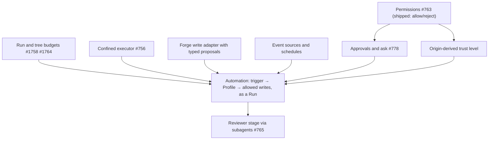

# Software factory as code

**Question:** what the "software factory as code" approach consists of, which parts of it fit llame's ownership and isolation contracts, and what llame would need before an owner could run one.

**Status:** noncanonical. The [openfabriq entry](../harnesses/openfabriq.md) records the source reading of openfabriq at `v0.1.6`.[^of-entry] Warp Factories, GitHub Agentic Workflows (gh-aw) and the Archon-based Dark Factory experiment were read from their example repositories and documentation only; none of the four systems was run. [VISION.md](../../../VISION.md) and [ROADMAP.md](../../../ROADMAP.md) own direction, and VISION currently defers workflow builders and automatic merge of self-authored changes.[^llame-vision-deferrals]

## The approach

A software factory, as these systems use the term, is a set of version-controlled files that binds events in a software project to role agents and to the writes each binding may make. The loop is the same in all four:

1. An event arrives: an issue label, a pull request, a failed check, a schedule, a chat mention, a production error.
2. A rule selects a role agent (triage, implementer, reviewer, investigator) and its tools.
3. The agent works in a disposable checkout and produces a result.
4. Something other than the agent verifies the result.
5. A bounded writer publishes it to the forge, and a person decides at a defined gate, usually the merge.

The files are the product: they are reviewed, diffed, reverted and tuned like code. The systems differ in where the files execute, who routes between stages, and who holds write authority.

## Four systems

| Aspect          | openfabriq                                                 | Warp Factories                                                             | gh-aw                                                           | Dark Factory (Archon)                                       |
| --------------- | ---------------------------------------------------------- | -------------------------------------------------------------------------- | --------------------------------------------------------------- | ----------------------------------------------------------- |
| Definition      | `openfabriq/` folder: factory, agents, automations, skills | `factory.yaml` (`v1alpha1`), agents, automations, runners, scorers, skills | Markdown with YAML frontmatter per workflow                     | Archon workflows under `.archon/workflows/`                 |
| Executes on     | One local engine or server, Claude Code                    | Warp-hosted runners; several harnesses                                     | GitHub Actions, compiled to a lock file                         | Archon on a cron, Claude Code                               |
| Routing         | Forge events; no orchestrator agent                        | A foreman agent routes each work item                                      | One workflow per trigger                                        | Deterministic workflow steps                                |
| Write authority | Engine applies typed proposals allowed by `can`            | Not established from the examples                                          | Separate permission-controlled jobs apply safe outputs          | The agent holds `gh`                                        |
| Human gate      | A person merges by default; conditioned merge is opt-in    | A person merges in the examples                                            | Depends on the safe-output configuration; merge is experimental | No human reads the diff; a fixed perimeter is auto-rejected |
| Verification    | Engine runs the checks before publication                  | Automated scorers                                                          | Workflow steps                                                  | Validation workflow before merge                            |
| Scope           | One repository per factory                                 | Several repositories per factory                                           | One repository                                                  | One repository                                              |

Sources: openfabriq;[^of-entry] Warp's examples, `02-sdlc` factory and documentation;[^warp-readme][^warp-factory][^warp-docs] gh-aw's overview and safe outputs;[^ghaw-overview][^ghaw-safe-outputs][^ghaw-merge] the Dark Factory README.[^dark-factory][^dark-factory-layers] openfabriq's `02-sdlc` template names Warp's example as its model and drops the foreman.[^of-sdlc]

The systems sit at two ends of write authority. gh-aw and openfabriq take it away from the agent entirely. The Dark Factory gives the agent `gh` and protects a perimeter that it is never allowed to change.[^dark-factory] Its README states the lesson directly: an autonomous system is only as trustworthy as the things it cannot change about itself.

## Mechanisms worth keeping

- **M1. Rules are activated, not read live.** openfabriq runs only an applied, fingerprinted copy of the folder, and `plan` shows security changes before `apply`.[^of-write-applied][^of-load-errors] gh-aw gets the same property by compiling the Markdown into a lock file that the Actions run executes.[^ghaw-overview] A pull request cannot change the rules that judge it.
- **M2. Agents propose; a trusted writer applies.** Typed output tools, an allowlist per binding, per-run caps, and no forge credential in the agent environment.[^of-output-tools][^of-can-refuse][^of-per-run][^ghaw-safe-outputs]
- **M3. Verification belongs to the harness.** The engine runs the project's checks after the agent stops and refuses code that fails them.[^of-check-gate] Warp's scorers grade results for later tuning.[^warp-readme]
- **M4. Trust follows the event's origin.** A maintainer's label and a stranger's issue start different capability sets; untrusted runs get no secrets and cannot merge.[^of-match-gate][^of-trusted]
- **M5. Loops are bounded structurally.** Self-triggering automations fail validation, comments start nothing, review rounds hand off to a person.[^of-self-trigger][^of-workflow-doc][^of-review-rounds]
- **M6. Tuning is a pull request.** A scheduled agent reads human reactions to the factory's work and proposes a small change to a brief or skill; the rights in headers change only through a person's apply.[^of-tuner]

## Mapping onto llame

| Factory concept                         | Closest llame primitive                                                                                                                                                                                                                         | Gap                                                                                                                                                                                                  |
| --------------------------------------- | ----------------------------------------------------------------------------------------------------------------------------------------------------------------------------------------------------------------------------------------------- | ---------------------------------------------------------------------------------------------------------------------------------------------------------------------------------------------------- |
| Factory folder and plan/apply (M1)      | Startup-frozen operator policy;[^llame-permissions-frozen] Workspace config overrides ([#976](https://github.com/leon0399/llame/issues/976))                                                                                                    | No owner-applied, fingerprinted rule snapshot; VISION keeps tool authorization out of profile files,[^llame-vision-profile] which M1 satisfies only if apply makes the snapshot control-plane state. |
| Agent definition                        | Agent Profiles (later);[^llame-vision-runs] agent definition files ([#1619](https://github.com/leon0399/llame/issues/1619)); shipped Skills                                                                                                     | Profiles are not shipped.                                                                                                                                                                            |
| Automation: trigger → agent → writes    | Nothing. pg-boss Runs start only from an authenticated Chat send; `external-identities` maps subjects for future channels.[^llame-external-identities]                                                                                          | No event source, no schedule, no binding record.                                                                                                                                                     |
| Typed proposals and trusted writer (M2) | Harness-owned execution;[^llame-vision-execution] proxied operations for executors;[^llame-vision-credentials] GitHub read adapter ([#995](https://github.com/leon0399/llame/issues/995), [#996](https://github.com/leon0399/llame/issues/996)) | No forge write adapter and no per-binding output allowlist.                                                                                                                                          |
| Disposable checkout                     | Worktree checkouts under a main checkout;[^llame-repositories-worktree] subagent worktree assignment and fate ([#1727](https://github.com/leon0399/llame/issues/1727), [#1728](https://github.com/leon0399/llame/issues/1728))                  | No unattended confined executor; sandbox failure must not downgrade to native.[^llame-vision-intent]                                                                                                 |
| Harness-run checks (M3)                 | Host `bash` with fenced effects                                                                                                                                                                                                                 | No acceptance gate between a Run's result and its publication.                                                                                                                                       |
| Origin trust (M4)                       | Per-Run permission mode chosen by the owner;[^llame-spec-permissions] permissions tracker ([#1488](https://github.com/leon0399/llame/issues/1488))                                                                                              | Trust is owner-chosen per Run, not derived from what started it.                                                                                                                                     |
| Needs-a-person handoff                  | `ask` and approvals ([#778](https://github.com/leon0399/llame/issues/778)); interactive approval does not ship[^llame-spec-permissions]                                                                                                         | Different shape: llame would suspend a Run; openfabriq labels the issue.                                                                                                                             |
| Budgets (`usd_per_run`, `usd_per_day`)  | Owner budget for subagent trees ([#1758](https://github.com/leon0399/llame/issues/1758)), tree limits ([#1764](https://github.com/leon0399/llame/issues/1764)), cost ledger ([#170](https://github.com/leon0399/llame/issues/170))              | Not shipped. openfabriq's start-time daily check fails open under concurrency.[^of-daily-limit][^of-cost-today]                                                                                      |
| Reviewer stage                          | Bounded subagents ([#765](https://github.com/leon0399/llame/issues/765)) and child Runs as background jobs ([#1763](https://github.com/leon0399/llame/issues/1763))                                                                             | Not shipped; B3 is last in the Next sequence.[^llame-roadmap-next]                                                                                                                                   |
| Board                                   | A projection over Runs and their subjects                                                                                                                                                                                                       | Cheap once the above exist; not a prerequisite.                                                                                                                                                      |

One structural difference decides the design. openfabriq keeps its pipeline state in GitHub labels and pull requests, and each stage is an independent run. In llame a Chat and its Runs are the durable identity of work,[^llame-vision-runs] so a llame factory firing creates an owner-owned Chat and Run with full provenance, and the forge receives only published results. Using labels as the state machine would make GitHub a second owner of Run state.

## What llame needs first

Event sources, schedules, origin-derived trust and the forge write adapter have no issue yet. Approvals, budgets and the confined executor already have issues, and approvals and run limits are in the roadmap's Next sequence.[^llame-roadmap-next] A factory needs no subagents for its first cut: openfabriq's stages are independent runs, and only `reviewed_by` is an in-run second agent.

## Conflicts with VISION

- **D1.** "Workflow builders" and "automatic merge or deployment of self-authored changes" are explicit deferrals.[^llame-vision-deferrals] A factory without a merge output does not touch the second. The first is the direct conflict; VISION says deferral is not rejection, and "installed Apps and workflows" is a later horizon.[^llame-vision-later]
- **D2.** VISION orders child-agent orchestration behind the single-agent personal loop.[^llame-vision-runs] A factory built from independent Runs avoids that dependency; a factory with a reviewer stage does not.
- **D3.** Unattended model-directed shell on the host conflicts with the disclosure and sandbox rules.[^llame-vision-intent] An unattended code-writing automation needs the confined executor first.
- **D4.** The credential rule is compatible: executors get proxied operations, never the upstream secret.[^llame-vision-credentials] M2 is that rule applied to the forge.

## Counterarguments

- **C1. The trust boundaries are still open.** Approvals, budgets and a confined executor are unshipped. Building triggers first would ship unattended Runs on host-user authority, which VISION rules out.
- **C2. Audience.** The four systems serve a team repository with maintainers. llame's next horizon is one owner's personal operation. A personal factory over the owner's own repositories fits; a team factory imports team authorization llame does not have.
- **C3. One trust domain per engine.** openfabriq runs every factory on a machine in one environment and one `gh` login.[^of-security-limits] llame is multi-user with forced RLS; owner-scoped bindings, credentials and budgets are mandatory, not later hardening.
- **C4. The distinctive parts are cheap without a factory.** M1 and M2 can land as a typed forge-write tool and an applied-configuration step for Workspace overrides, with no event layer. They are worth doing before deciding on triggers.
- **C5. Maturity.** openfabriq is two days old with one maintainer and a CLA that permits relicensing;[^of-cla] Warp Factories is a hosted product at `v1alpha1`. Treat both as mechanism references, not dependencies.

## Candidate shape for llame

Noncanonical and unapproved; it records where the mechanisms would land.

- An **Automation** is an owner-scoped record: a trigger source, an Agent Profile, the proposal tools it may use with their allowlists, the checks, and a budget. It is authored as files in a Workspace or Profile Space and becomes effective only through an explicit apply that shows the security diff and stores a fingerprint (M1).
- Each firing creates a Chat and a Run owned by the Automation's owner, with the event as trusted-harness provenance and the event content as framed data. The Run's permission ceiling derives from the event's origin (M4).
- The Run's results are proposals. A trusted forge adapter applies the allowed ones after the harness has run the checks in the Run's checkout (M2, M3). Refusals and applications are Run events.
- A Run that needs a person suspends through the approval flow ([#778](https://github.com/leon0399/llame/issues/778)) rather than labeling the forge, and the owner can steer it in its Chat.
- Budgets reserve before start and settle per model request, per Run and per Automation per day ([#1758](https://github.com/leon0399/llame/issues/1758)).
- Tuning is an ordinary Automation whose only proposal tool opens a change against the Automation files; rights change only through apply (M6).

## Open questions

- **Q1.** Which trigger sources come first for a personal owner: schedules, GitHub events on the owner's repositories, or both? Polling, as openfabriq does, needs no inbound endpoint; webhooks need one per owner.
- **Q2.** Does apply belong to the owner, the operator, or both, and how does it interact with the startup-frozen operator policy?[^llame-permissions-frozen]
- **Q3.** Is the reviewer stage a subagent inside the Run, or a second Automation that reviews the published result?
- **Q4.** What is the minimum forge-write vocabulary? openfabriq's ten actions and gh-aw's larger set are the reference points.

[^of-entry]: [openfabriq harness reference entry](../harnesses/openfabriq.md)

[^llame-vision-deferrals]: [Explicit deferrals: workflow builders, automatic merge](https://github.com/leon0399/llame/blob/9423a655bf599cb23307c0b51a2cd2cc952bf58e/VISION.md#L331-L352)

[^warp-readme]: [Warp Factories examples: a foreman routes work; multi-harness and review-only examples](https://github.com/warpdotdev/warp-factory-examples/blob/76f0f06f59a3c3d5fc29eb7699fe281073fa58c1/README.md#L1-L40)

[^warp-factory]: [Warp 02-sdlc factory.yaml: schema v1alpha1, several repositories, runners](https://github.com/warpdotdev/warp-factory-examples/blob/76f0f06f59a3c3d5fc29eb7699fe281073fa58c1/examples/02-sdlc-issue-to-pr/factory.yaml#L1-L22)

[^warp-docs]: [Warp Factories documentation](https://docs.warp.dev/factories/)

[^ghaw-overview]: [gh-aw compiles Markdown workflows into hardened GitHub Actions lock files](https://github.com/github/gh-aw/blob/26ba0cc475162c8bc0217246fa45541645e36f5c/docs/src/content/docs/introduction/overview.mdx#L9-L51)

[^ghaw-safe-outputs]: [gh-aw safe outputs: the agent requests, separate permission-controlled jobs write](https://github.com/github/gh-aw/blob/26ba0cc475162c8bc0217246fa45541645e36f5c/docs/src/content/docs/reference/safe-outputs.md#L8-L30)

[^ghaw-merge]: [gh-aw merge-pull-request safe output is experimental](https://github.com/github/gh-aw/blob/26ba0cc475162c8bc0217246fa45541645e36f5c/docs/src/content/docs/reference/safe-outputs.md#L135)

[^dark-factory]: [Dark Factory experiment: agents merge; a human-authored perimeter is auto-rejected](https://github.com/coleam00/dark-factory-experiment/blob/eaf804b4cad7606496d54298b9c42d47731119d0/README.md#L3-L5)

[^dark-factory-layers]: [Archon workflows spawn Claude Code with gh and bash](https://github.com/coleam00/dark-factory-experiment/blob/eaf804b4cad7606496d54298b9c42d47731119d0/README.md#L23-L24)

[^of-sdlc]: [02-sdlc follows Warp's example without a foreman](https://github.com/openfabriq/openfabriq/blob/2a183bf053a27d52bf9fc733a2db6159773325df/examples/02-sdlc/README.md#L7)

[^of-write-applied]: [apply writes the folder through a staging copy and records a fingerprint](https://github.com/openfabriq/openfabriq/blob/2a183bf053a27d52bf9fc733a2db6159773325df/packages/runner/src/state/projects.ts#L104-L131)

[^of-load-errors]: [Any validation error yields no factory](https://github.com/openfabriq/openfabriq/blob/2a183bf053a27d52bf9fc733a2db6159773325df/packages/core/src/factory/load.ts#L139-L145)

[^of-output-tools]: [Only output tools allowed by can are registered](https://github.com/openfabriq/openfabriq/blob/2a183bf053a27d52bf9fc733a2db6159773325df/packages/runner/src/run/outputs/tools.ts#L182-L190)

[^of-can-refuse]: [A proposal not in can is refused](https://github.com/openfabriq/openfabriq/blob/2a183bf053a27d52bf9fc733a2db6159773325df/packages/runner/src/run/outputs/review.ts#L82-L86)

[^of-per-run]: [Per-run write caps](https://github.com/openfabriq/openfabriq/blob/2a183bf053a27d52bf9fc733a2db6159773325df/packages/runner/src/run/outputs/review.ts#L34-L42)

[^of-check-gate]: [A failed check refuses every code proposal](https://github.com/openfabriq/openfabriq/blob/2a183bf053a27d52bf9fc733a2db6159773325df/packages/runner/src/run/outputs/review.ts#L186-L192)

[^of-match-gate]: [Only maintainers start GitHub-triggered automations unless from: anyone](https://github.com/openfabriq/openfabriq/blob/2a183bf053a27d52bf9fc733a2db6159773325df/packages/core/src/match.ts#L125-L150)

[^of-trusted]: [Sentry, webhooks and strangers start untrusted runs](https://github.com/openfabriq/openfabriq/blob/2a183bf053a27d52bf9fc733a2db6159773325df/packages/core/src/match.ts#L183-L192)

[^of-self-trigger]: [Validation refuses an automation whose own output starts it again](https://github.com/openfabriq/openfabriq/blob/2a183bf053a27d52bf9fc733a2db6159773325df/packages/core/src/factory/automation-rules.ts#L17-L40)

[^of-workflow-doc]: [What starts what; comments start nothing](https://github.com/openfabriq/openfabriq/blob/2a183bf053a27d52bf9fc733a2db6159773325df/packages/docs/content/docs/factory/workflow.mdx#L50-L63)

[^of-review-rounds]: [review_rounds reached hands the subject to a person](https://github.com/openfabriq/openfabriq/blob/2a183bf053a27d52bf9fc733a2db6159773325df/packages/runner/src/run/execute.ts#L197-L207)

[^of-tuner]: [The tuner may edit only bodies and skills](https://github.com/openfabriq/openfabriq/blob/2a183bf053a27d52bf9fc733a2db6159773325df/examples/17-factory-tuner/openfabriq/agents/tuner/agent.md#L13-L19)

[^llame-permissions-frozen]: [Execution policy is frozen per process](https://github.com/leon0399/llame/blob/9423a655bf599cb23307c0b51a2cd2cc952bf58e/openspec/specs/tool-call-permissions/spec.md#L465-L467)

[^llame-vision-profile]: [Tool authorization stays control-plane state outside profile files](https://github.com/leon0399/llame/blob/9423a655bf599cb23307c0b51a2cd2cc952bf58e/VISION.md#L273-L279)

[^llame-vision-runs]: [Runs are the unit of execution; peer agents stay adapters](https://github.com/leon0399/llame/blob/9423a655bf599cb23307c0b51a2cd2cc952bf58e/VISION.md#L119-L139)

[^llame-external-identities]: [External identity mapping for future channels](https://github.com/leon0399/llame/blob/9423a655bf599cb23307c0b51a2cd2cc952bf58e/openspec/specs/external-identities/spec.md#L3-L5)

[^llame-vision-execution]: [The harness owns execution](https://github.com/leon0399/llame/blob/9423a655bf599cb23307c0b51a2cd2cc952bf58e/VISION.md#L78-L88)

[^llame-vision-credentials]: [Executors receive proxied operations, not upstream secrets](https://github.com/leon0399/llame/blob/9423a655bf599cb23307c0b51a2cd2cc952bf58e/VISION.md#L242-L246)

[^llame-repositories-worktree]: [Worktree checkouts are children of a main checkout](https://github.com/leon0399/llame/blob/9423a655bf599cb23307c0b51a2cd2cc952bf58e/openspec/specs/repositories/spec.md#L108-L111)

[^llame-vision-intent]: [Workspace entry is authorized by the harness; sandbox failure never downgrades](https://github.com/leon0399/llame/blob/9423a655bf599cb23307c0b51a2cd2cc952bf58e/VISION.md#L195-L206)

[^llame-spec-permissions]: [Allow/reject permissions ship; interactive approval does not](https://github.com/leon0399/llame/blob/9423a655bf599cb23307c0b51a2cd2cc952bf58e/SPEC.md#L77)

[^of-daily-limit]: [usd_per_day is checked when a run starts](https://github.com/openfabriq/openfabriq/blob/2a183bf053a27d52bf9fc733a2db6159773325df/packages/runner/src/run/execute.ts#L177-L184)

[^of-cost-today]: [Daily cost sums the journal and counts a missing cost as zero](https://github.com/openfabriq/openfabriq/blob/2a183bf053a27d52bf9fc733a2db6159773325df/packages/runner/src/state/journal.ts#L177-L183)

[^llame-roadmap-next]: [Next: permissions, approvals, skills, sessions, todos, subagents](https://github.com/leon0399/llame/blob/9423a655bf599cb23307c0b51a2cd2cc952bf58e/ROADMAP.md#L30-L59)

[^llame-vision-later]: [Later horizons: workflows, child agents, harness adapters](https://github.com/leon0399/llame/blob/9423a655bf599cb23307c0b51a2cd2cc952bf58e/VISION.md#L309-L324)

[^of-security-limits]: [Known limits of the security model](https://github.com/openfabriq/openfabriq/blob/2a183bf053a27d52bf9fc733a2db6159773325df/packages/docs/content/docs/reference/security.mdx#L39-L58)

[^of-cla]: [The CLA lets the maintainer relicense contributions](https://github.com/openfabriq/openfabriq/blob/2a183bf053a27d52bf9fc733a2db6159773325df/CLA.md#L1-L5)
