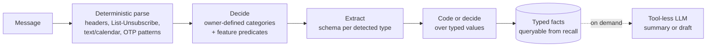

# System One extraction models

The existing [System One research](./2026-09-23-system-one-jev/index.md)
covers decision models only: Jev, Clef and OpenAI's Decisions API pick among
listed options and return probabilities. Cloudflare's Clairic adds a second
class, extraction, which returns **values** taken from, computed from, or
predicted beyond the input.[^clairic-blog] This note records that class, a
decision-gated RAG example, and llame applications numbered U32-U39 after the
existing U1-U31.

## Three model classes

|          | System One: Decide                          | System One: Extract                            | System Two                 |
| -------- | ------------------------------------------- | ---------------------------------------------- | -------------------------- |
| Examples | Jev, Clef, OpenAI Decisions                 | Clairic                                        | GPT, Claude, GLM           |
| Output   | One of the listed options, with probability | A typed value or null, with confidence         | Free-form text             |
| Answers  | Which category? Is it legitimate?           | What is the amount? When? How much will it be? | Why? How? Write the reply. |
| Pass     | One forward pass, no output tokens          | One forward pass, no output tokens             | Token by token             |

Source: Cloudflare's comparison table, condensed.[^clairic-blog]

## Clairic request and answer

A request is a `state` (text plus up to four inline images) and a map of named
`fields`, each with a type and optional plain-language `instructions`. Field
types are `text`, `number`, `date`, `time`, `datetime`, `duration`, `list`,
`estimate` and `forecast`; `reference_date` anchors dates written without a
year.[^clairic-model]

- **`text`** answers are spans of the input with character offsets, so every
  copied value is traceable to its source position.
- **Scalar** answers carry `p_null`, the probability that the input does not
  determine the value, plus `confidence` and the model's `guess`. `value` is
  null when `p_null` is high.
- **`estimate`** answers are a distribution inside declared `min`/`max` bounds
  on a declared grid, with median and `p10`-`p90` interval.
- **`forecast`** answers are one estimate per future step of a series.

Fields answer in parallel. A pass holds 8,192 tokens of state plus field
definitions; fields that do not fit are split into further passes that each
re-read the whole state, and the response reports `passes` and
`truncated`.[^clairic-model]

### Limits the vendor states

- One- and two-step arithmetic is reliable; longer dependent chains and
  aggregation across many table rows are not. Cloudflare recommends extracting
  values and computing in code.
- Estimates need evidence in the input; interval calibration is measured on
  held-out sets, not guaranteed, and can run narrow on unfamiliar data.
- Answers are always well typed, not always correct.[^clairic-blog]

The article's own example shows the last point: the absent `tracking_number`
field picks the span `"$52.10"` with 0.42 confidence and is nulled only because
`p_null` is 1. A consumer that ignores `p_null` and `confidence` receives
well-typed wrong values.[^clairic-blog]

## Composition

Cloudflare's cascade runs **extract, then decide, then generate**: Clairic turns
a damage-claim email into typed facts, Clef chooses refund or repair from a
five-line summary of those facts plus policy, and an LLM writes the reply from
the decision alone. The decision model and the writer never read the raw email,
which removes most of the email's text from the injection path.[^clairic-blog]

The order follows from the dependency. Extraction comes first when the decision
depends on extracted values. Decision comes first when the extraction schema
depends on the document type, as in mail triage below. A third step usually
follows either order: a judgment or a code check over the extracted values.

### Benchmark caveats

Cloudflare reports 19.3 s against 61.7 s end to end and 49% lower cost than an
all-GLM-5.3 pipeline.[^clairic-blog] Two properties of that comparison limit
transfer:

- The baseline uses a reasoning model for extraction and decision (16.1 s and
  21.9 s). A small non-reasoning model with structured output is the
  realistic alternative and was not measured.
- The reply step dominates both pipelines: 18.6 s of 19.3 s, and about 97% of
  the cascade's cost in output tokens.

No llame measurement exists; the numbers are vendor reports.

## Decision-gated RAG

The Daily Dose build retrieves text chunks and rendered page images with a
multimodal embedder, has a decision model score each candidate for relevance
and answerability, widens the search once on failure, and opens a human ticket
instead of calling the generator when no candidate passes.[^jev-rag] Thresholds
live in a table so they can change without code. Its 75-question evaluation
reports the decision gate as the only pipeline that kept full accuracy on
image-only questions; the result table is published as an image and was not
reproduced.

This pattern is already covered by U1, U5 and U13 in the
[Jev report](./2026-09-23-system-one-jev/report.md).[^jev-report] Two details
are new for llame:

- Record the threshold values used with each attempt, since they change
  independently of code.
- A human answer saved back into retrieval must stay tagged as a reply so it
  is not later treated as source evidence.

## Pricing

Clairic costs $0.10 per million input tokens and charges nothing for
output.[^clairic-model] Three properties shape the real cost:

- **Field definitions dominate short inputs.** In the documented invoice
  example, the state is 61 tokens and the field definitions 472 of 655 billed
  input tokens.[^clairic-model] Routing a document to a type-specific schema
  saves more than shortening the document.
- **Long inputs multiply by passes.** Each extra pass re-reads the full state.
- **The saving against the cheapest small LLMs is mostly output and retries.**
  Their input rates sit in a similar band (low-to-moderate confidence; check
  current rates); Clairic removes output and reasoning tokens and the
  JSON-repair retries. Against mid-tier and frontier models the input rate
  alone is an order of magnitude or more lower.

Low per-message cost changes design at volume. At an assumed 2,000 billed tokens
per message (text after HTML conversion plus one schema; not measured),
backfilling 100,000 messages costs about $20 for one extraction pass. That makes
classifying and extracting every item at ingest affordable, where a mid-tier
LLM would push the work to on-demand processing.

## llame applications

Proposals, not approved features. All need a provider client for the model
class, which llame does not have: `models[]` covers generative wires only, and
Jev, Clef, OpenAI Decisions and Clairic each use a different request shape.
Start with one concrete client; a shared wire follows a second backend. Every
call sends its state to the provider, with the egress caution
[Decision APIs](./2026-10-08-decision-apis.md) records as R1.[^decision-apis]

| ID  | Application                                                                                                                                                                                    | New relative to U1-U31                                                                                                                                 | Assessment                                                                                                                                                                                                                                                                                                              |
| --- | ---------------------------------------------------------------------------------------------------------------------------------------------------------------------------------------------- | ------------------------------------------------------------------------------------------------------------------------------------------------------ | ----------------------------------------------------------------------------------------------------------------------------------------------------------------------------------------------------------------------------------------------------------------------------------------------------------------------- |
| U32 | **Quarantined reads of untrusted content.** Web `read`, MCP and future mail results pass through extraction with a typed schema; the tool-holding model sees typed fields instead of raw text. | A separate, tool-less reader with typed output.                                                                                                        | Highest value, moderate confidence. Numbers, dates and durations cannot carry instructions; `text` spans can, so only non-text fields are injection-free. Needs an explicit model- or tool-selected mode, never a silent replacement of raw reads. Belongs beside [#778](https://github.com/leon0399/llame/issues/778). |
| U33 | **Grounded exact-value answers.** Return a value from `conversation_read` or `kb://` content as a span with offsets.                                                                           | Offsets are the citation locator, giving U5 support checking for free on that value; replaces the candidate-selection construction of U22.[^cookbooks] | High, moderate confidence. Smallest experiment.                                                                                                                                                                                                                                                                         |
| U34 | **Temporal recall filter.** Turn "last Tuesday's Redis discussion" into `datetime`/`duration` fields, then a `search_conversations` time filter.                                               | One call replaces date extraction plus code arithmetic in U21.[^cookbooks]                                                                             | Moderate. Within the reliable one-step arithmetic range; code still owns time zones.                                                                                                                                                                                                                                    |
| U35 | **Field-level extractive compaction.** Keep failing test names, error spans, `file:line` locations and exit codes verbatim from long tool output; drop the rest.                               | Spans inside one message, complementing Jev's per-message extractive compaction.                                                                       | Moderate. Constrained by the compaction and prompt-cache contracts in [SPEC.md](../../../SPEC.md).                                                                                                                                                                                                                      |
| U36 | **Image facts for text-only models.** Extract typed facts from an attached receipt or screenshot before a turn on a `models[].input: ["text"]` model.                                          | Capability bridge.                                                                                                                                     | Low to moderate. Anything the schema does not request is lost, invisibly to the main model.                                                                                                                                                                                                                             |
| U37 | **Run output reserve estimate.** An `estimate` of a Run's output tokens from the owner's prior Runs, replacing the fixed `runs.maxOutputTokens` reserve.                                       | Distribution output.                                                                                                                                   | Low. Plain statistics in code likely match it without a model call.                                                                                                                                                                                                                                                     |
| U38 | **Bundled mail client triage.** Decide, then extract, at ingest; see below.                                                                                                                    | Combines U32 with a native mail source and Knowledge-backed recall.                                                                                    | Later horizon.                                                                                                                                                                                                                                                                                                          |
| U39 | **Decision-gated recall abstention.** Abstain or ask when no recalled candidate passes an answerability gate, logging the thresholds used.                                                     | Threshold logging and reply tagging from the Daily Dose build.                                                                                         | Extends U1/U13; small.                                                                                                                                                                                                                                                                                                  |

Chat titles are a poor fit despite being llame's only structured-generation
call today: a title is new text, not a span, number or date from the input.

### U38: bundled mail client

A future bundled client, native rather than MCP-backed, supports several
accounts per owner and owns sync state, threading, per-account identity and
row-level tenant isolation, guarantees an MCP server cannot give. Triage runs at
ingest:

- **Decide** classifies into owner-configured categories, each with a
  plain-language description in the Gmail Promotions/Social/Updates/Forums
  style, and answers one predicate per feature: event or invitation, invoice,
  receipt, one-time password, ticket, pass.
- **Extract** runs only the schemas for detected features, which keeps the
  billed field definitions small: amount and due date for an invoice, start
  time and location for an event.
- **Code** handles comparisons such as "due within seven days"; a decision
  model handles judgments over values, such as whether an invoice looks
  fraudulent.
- **System Two** runs on request, reads the raw message, and holds no tools.
  The agent that holds tools sees only typed facts and owner-approved spans.

Prerequisites, in dependency order:

1. **User-owned credentials.** Consumer Gmail and Outlook accounts largely
   require OAuth. [VISION.md](../../../VISION.md) defers user-managed
   credentials and managed OAuth connector onboarding, and mail credentials
   would be the first secrets owned by users rather than the operator. This
   needs its own threat model.
2. **Sync engine.** IMAP IDLE and CONDSTORE or JMAP, per-account cursors, and
   delete and move semantics. Most of the build is here.
3. **Egress decision.** Every message goes to the extraction provider and the
   decision provider. Open weights would remove that only after the VISION
   deferral of llame-managed local inference is lifted.
4. **Deferral review.** VISION defers autonomous mail actions and semantic fact
   extraction; ingest-time typed facts touch the second.

## Next experiments

1. **U33 offline.** About 30 real chat and Knowledge questions through Clairic
   against the current read-then-answer path: span accuracy, `p_null`
   behavior on unanswerable questions, latency, billed tokens. This also tests
   calibration on llame data, the vendor's stated weak point.
2. **U32 design** alongside #778, since it changes the security model.
3. **U38 sample** on real mail once credentials exist: category accuracy,
   `p_null` on wrong-type messages, and measured tokens per message to replace
   the 2,000-token assumption.

## Sources

[^clairic-blog]: [Introducing Clairic](https://blog.cloudflare.com/clairic-extraction-model/)

[^clairic-model]: [Workers AI clairic model page](https://developers.cloudflare.com/workers-ai/models/clairic/)

[^jev-rag]: [Build a Jev-powered Agentic RAG](https://blog.dailydoseofds.com/p/build-a-jev-powered-agentic-rag)

[^jev-report]: [System One and Jev report](./2026-09-23-system-one-jev/report.md)

[^cookbooks]: [TypeSafe cookbook applicability and ideas](./2026-09-23-system-one-jev/cookbooks.md)

[^decision-apis]: [Decision APIs](./2026-10-08-decision-apis.md)
