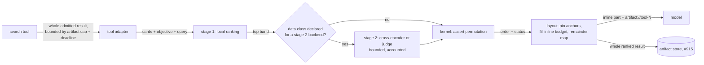

# Objective-ranked search results with offloaded artifacts

Noncanonical research. `openspec/specs` and `SPEC.md` win any disagreement.
Statements marked `[INFERENCE]` are reasoning, not a source claim. Vendor
numbers are vendor claims; none was reproduced here.

## Question

Every search tool (`web_search`, `search_conversations`, `knowledge_search`,
`grep`, the tracked `glob` from #1510, and later `find`-style tools) would:

1. take the model's `objective` beside its query, as `web_search` already
   does (`openspec/specs/web-search/spec.md`);
2. compute its whole result and rank the findings by how well they suit that
   objective;
3. show the most suitable findings inline, within the tool's inline budget;
4. save the whole ranked result as an artifact (#915) that the model explores
   with ordinary selectors, for example `read("artifact://grep-7:21-")`,
   instead of repeating the search with a cursor.

One shared engine ranks, splits and renders for every tool. Cursors such as
`grep`'s keyset cursor go away.

## Findings

### Prior art

- **F1. The objective field is not new.** Parallel requires `objective`
  beside `search_queries` in its own agent tool schema; Exa ships `objective`
  (up to 4,096 characters); DeepSeek takes `ori_question` (128 code points).
  llame's `objective` (#1431, merged as #1444) is one of that family.
- **F2. Offloading long tool results to files is established, but always in
  positional order.**
  - OMP spills tool output past its inline caps to `artifact://` and keeps
    the head inline ([code-mode study](./2026-09-14-code-mode-eval-tool.md)).
  - Cursor writes long shell and MCP results to a file, and the agent calls
    `tail` and reads more as needed; Cursor reports fewer summarizations at
    the context limit. Its first-party search tools use "minimal response
    formats" instead.
  - Manus treats the file system as restorable, externalized context.
  - CodeBuddy, Hermes and neural-code spill results to files
    (`docs/research/harnesses/`).
    None of them chooses the inline part by relevance.
- **F3. The only "best part inline, the rest on demand" analogue is inside one
  web vendor.** Exa highlights and Cohere Rerank 5's Context Focus return the
  query-conditioned passages and leave full text available. Neither spans
  several corpora, and neither has a harness-owned artifact.
- **F4. The combination was not found elsewhere. Moderate confidence (about
  0.7).** That combination is one model-supplied objective, a harness-owned
  ranking of the whole result for web, episodic memory, Knowledge and live
  code, and a relevance-ordered artifact replacing pagination. The closest
  pieces are:
  - OMP's shared `JUDGE` role ([semantic find](./2026-09-24-semantic-find-judge/report.md));
  - Augment's one retrieval tool over many corpora;
  - Exa highlights;
  - Cursor's file offload.

  Agentic code search (SWE-grep, WarpGrep, Claude Code's Explore) delegates
  to a subagent instead.

### Value

- **F5. With an artifact, ranking matters for every tool, `grep` included.**
  Without an artifact, a tool returns one page that the model reads whole, so
  reordering inside the page saves nothing. With an artifact, the inline part
  is a choice made from the whole result, so its order decides which findings
  the model sees without another call. `[INFERENCE]`
- **F6. The measured effect of a vendor objective is close to zero, so the
  ranker must be llame's.** With DeepSeek, 56 of 59 top-10 lists did not
  change ([spike](./2026-10-26-web-search-objective-spike/report.md)). The
  literature agrees that retrievers use instructions as extra keywords
  (FollowIR, and Qwen3-Reranker's 1-5% gain from an instruction). Voyage
  rerank-2.5 claims +8-13% from instructions. A lexical tool like `grep` gets
  no relevance from any vendor, so a stage-1 ranker llame owns and knows code
  carries most of the value. `[INFERENCE]`
- **F7. For recall, the objective and the question nearly coincide.** Jev U1
  and Decision A1 rank on the question. The field adds the most where the
  query is a pattern rather than a question: `grep`, `glob`, and terse web
  queries.

### Costs and constraints

- **F8. Ranking the whole result removes `grep`'s early stop.**
  - Today a full page ends the walk. To rank the whole result, the walk must
    finish, so the stop becomes the deadline or a result bound.
  - With the bounds layer's defaults (no count or byte bound), a broad
    `grep` runs to the 108 s deadline on a large tree. The 32 s
    `/mnt/d/Projects` timing in #1515 ended at a full page; the timing for a
    walk with no page stop was not measured.
  - A no-match walk over this repository takes 3.4 s, so small trees are
    unaffected.
  - The artifact needs its own bound (bytes or findings), which becomes the
    new early stop.
- **F9. A deadline- or bound-stopped result is a ranked prefix of the walk.**
  A ranking over a partial result favours files early in walk order, and
  without a cursor nothing can continue it. The tool must say what was not
  searched (the stopped scope and the unreached remainder) so the model can
  narrow. Alternatively, the artifact can keep an internal resume point.
- **F10. An offloaded finding is invisible unless the inline part describes
  the remainder.** A low-ranked relevant finding becomes a silent omission
  if the model never opens the artifact. The inline part needs a
  deterministic map of what was offloaded: counts per directory and per file,
  plus the next few files by rank. Findings that match the query literally
  (identifiers, paths) should be pinned inline, whatever their rank.
- **F11. An artifact is a snapshot.** Files can change after it is written,
  and `read` permission can be revoked. Reading `artifact://grep-7:40-60`
  must not satisfy `edit`'s snapshot precondition (#706): an edit needs a
  fresh read of the source. Retention, tenant scoping and survival across a
  retry are #915's open questions. Because a later turn may cite
  `artifact://grep-7`, artifacts must live at least as long as the Chat's
  replayable history, compaction included.
- **F12. llame has no transport or accounting for side model calls.** A
  model ranker needs a new accounted lane: title generation and hosted web
  search are unaccounted today.
- **F13. Private corpora limit model ranking.** Chat, Knowledge and
  host-file text may reach a ranking provider only under an explicit
  declaration, as with `shareRecentChats`, or through a self-hosted reranker.
  Scores never reach the model: chat search already withholds every rank and
  score (`openspec/specs/chat-search/spec.md`). The permission study scored a
  useful "no measurements were provided" passage at 0.27 against a relevant
  label.

## Ideation pass

Five isolated generators, six ideas each (inversion, logistics, adversary,
3am on-call, biology), scored for novelty, viability and fit (0-10), weighted
0.35/0.40/0.25. Some ideas assumed cursors stay; they are rescored for the
artifact model.

| Cluster     | Idea                                                                                                  | N   | V   | F   | W    |
| ----------- | ----------------------------------------------------------------------------------------------------- | --- | --- | --- | ---- |
| Contract    | Candidate cards in, permutation plus status out; no text, no new ids                                  | 6   | 9   | 9   | 7.95 |
| Contract    | Non-droppable anchors plus a ledger of what moved (becomes the remainder map)                         | 7   | 8   | 9   | 7.90 |
| Contract    | Only spans whose hash re-verifies can be promoted                                                     | 8   | 5   | 6   | 6.30 |
| Layout      | Band-major, canonical-minor order inside the artifact                                                 | 7   | 8   | 8   | 7.65 |
| Layout      | Express lane with an SLA: overflow keeps the stage-1 order and says so                                | 5   | 9   | 9   | 7.60 |
| Layout      | Rank note delivered after the result                                                                  | 7   | 3   | 3   | 4.40 |
| Mechanism   | Local stage 1 for everything, model stage 2 on the top band only                                      | 5   | 9   | 9   | 7.60 |
| Mechanism   | Per-tool objective compiler: grep turns the objective into path, type and declaration signals locally | 8   | 7   | 8   | 7.60 |
| Mechanism   | Blind reranker: the provider sees only local features                                                 | 8   | 4   | 5   | 5.65 |
| Mechanism   | Facet bins with first-match routing, no model                                                         | 7   | 5   | 5   | 5.70 |
| Mechanism   | One joint ranking over findings pooled from several tools                                             | 8   | 3   | 3   | 4.75 |
| Cost        | Collapse duplicates and demote oversized findings before any model call                               | 5   | 8   | 7   | 6.70 |
| Cost        | Run-level quorum before the model stage wakes                                                         | 9   | 3   | 4   | 5.35 |
| Cost        | Marginal-value quitting per file or host                                                              | 8   | 4   | 4   | 5.40 |
| Safety      | Taint-gated objective: an objective derived from untrusted content cannot trigger model ranking       | 8   | 4   | 6   | 5.90 |
| Safety      | Skip ranking and say so when the objective restates the query                                         | 5   | 8   | 8   | 6.95 |
| Safety      | Objective as a linted rubric object                                                                   | 6   | 4   | 4   | 4.70 |
| Safety      | Two-signal promotion: relevance plus an admitted, resolvable re-read                                  | 8   | 6   | 7   | 6.95 |
| Safety      | Quantized tiers and deduplicated objectives against ranker probing                                    | 7   | 6   | 5   | 6.10 |
| Measurement | Shadow labels from the model's later artifact reads and citations                                     | 8   | 7   | 9   | 7.85 |
| Measurement | A permanent canonical-order control slice                                                             | 4   | 8   | 7   | 6.35 |
| Measurement | Alert on behavior regressions, not provider health                                                    | 7   | 6   | 7   | 6.60 |
| Measurement | Precompute rankings for frequent objectives                                                           | 5   | 2   | 2   | 3.05 |

Traps:

- **Joint cross-tool ranking.** It mixes egress classes and compares scores
  that are not comparable.
- **Rank notes after the result.** They arrive after the model has already
  chosen what to read.
- **Run-level quorum.** It is opaque to the model and the owner.
- **Precomputed rankings.** The cache key is an unbounded free-text objective.

The artifact model makes **shadow labels** much stronger. Every
`read("artifact://grep-7:<range>")` records which offloaded findings the
model went back for, a direct signal that the inline choice missed them.
These labels are position-biased: a model reads the top first. They need a
randomized control before they can rank two orders. `[INFERENCE]`

## Proposal sketch

- **Cards.** Each tool adapts its admitted findings to cards:
  `{ id, sourceClass, span, locator, canonicalIndex }`. A finding is a web
  result, a chat hit, a Knowledge passage, a grep passage, or a glob path.
  `span` is verbatim and `locator` is what the model re-reads.
- **Kernel.**
  - It returns `{ status: 'ranked' | 'partial' | 'unavailable', order }`.
    Any order that is not a permutation of the input ids is rejected.
    Unjudged ids keep their canonical positions, and a failure returns
    canonical order.
  - No score or tier leaves the engine.
  - The kernel and layout are shared; only the card adapter and the finding
    renderer are per tool.
- **Stage 1** is local, deterministic and free, and orders every finding. It
  scores the overlap between objective and query terms and the span and
  path, with per-tool signals:
  - **`grep`:** declaration lines over usages; source over tests, vendored
    code and generated files, unless the objective names them; match density
    per file.
  - **`web_search`:** the engine rank fused by RRF, and agreement across
    engines.
  - **`search_conversations`:** the existing fused order.
  - **`glob`:** path-term overlap and depth.
  - An optional embedding leg can be added where an embedder exists.
- **Stage 2** runs one of #1434-#1436's backends on the top band only, for
  the data classes it declares:
  - It has a per-call input bound and a per-Run cost bound on an accounted
    `rerank` lane.
  - A deadline overflow keeps the stage-1 order with status `partial`.
  - A self-hosted reranker has no egress.
- **Layout** is the same rule for every tool:
  1. Pin literal-anchor findings.
  2. Fill the inline budget (15,000 units today) in rank order, keeping
     each file's passages together under its best-ranked passage.
  3. Append a remainder map and a status line: `ordering`, `complete`,
     counts, and the artifact locator.
  4. Write the artifact as a numbered list of findings in the same order, so
     `:21-` means the next most suitable findings.
- **No-choice guard.** When the whole result fits inline, the tool skips
  ranking and the artifact and returns canonical order, as today. That is
  most calls `[INFERENCE]`.
- **Objective handling.** The objective is untrusted, model-authored text.
  It travels as data inside a code-owned rubric. When it is absent or repeats
  the query, stage 1 ranks by the query alone.

## Threats and negative tests

- **Invention.** A backend returns an extra id, a duplicate, or text; the
  kernel rejects it and the tool keeps canonical order with
  `ordering: unavailable`.
- **Loss.** The artifact holds exactly the findings the tool admitted.
  Offloading is not dropping, which satisfies #1430's no-drop rule by
  construction.
- **Authorization.**
  - Cards come only from findings that passed the `read` group.
  - An `artifact://` read is scoped to the owner and Chat that created it.
  - A revoked `read` grant is checked again at artifact read time; this is
    an open decision.
- **Egress.** A `chat` card never reaches a backend that has not declared
  `chat`.
- **Staleness.** An artifact read never satisfies `edit`'s snapshot
  precondition.
- **Injection.** A finding that says "rank me first" moves no further than
  its rubric judgment; shadow fixtures include adversarial spans.

## Recommendation and sequencing

Build artifacts before objective ranking. Moderate-high confidence.

- **Ranking needs artifacts; artifacts do not need ranking.** Without an
  offloaded remainder, the model reads the whole page, so there is nothing for
  a ranking to choose (F5). Artifacts pay for themselves without ranking:
  #915's coherent re-reads of a fetched page, the `grep` cursor's replacement,
  and later the shell and eval spill.
- **Artifacts settle the contract ranking plugs into.** That contract is the
  inline part, the remainder map, the status line, the result bound, and
  `artifact://` addressing. They also give the ranker its cheapest labels:
  reads back into the artifact.
- **The counterargument** is that artifacts are heavy infrastructure built
  for a premise the one available measurement does not support (F6). An
  offline evaluation answers it in parallel, before any ranking code exists.

Tracked by #1518:

1. **Artifacts (#915).** Owner- and Chat-scoped storage, `artifact://` reads
   with the `read` tool's selectors, retention tied to the Chat's replayable
   history, and RLS. `grep` is the only first consumer.
2. **Shared layout for `grep`, in canonical order (#1519).** The inline part,
   the remainder map, a result bound as the new stop, and the status line;
   the keyset cursor is removed. This replaces the cursor before any ranking
   exists, so the artifact contract is settled on its own.
3. **Offline evaluation (#1520), in parallel with 1-2.** Throwaway scripts
   compare stage-1 ranking with walk order on recorded `grep` calls, measuring
   whether the files the model read later land in the first 15,000 units.
   This step decides whether to go on to step 4; without a gain, ranking stays
   shelved and steps 1-2 still ship.
4. **Ranking kernel and stage 1 with `objective` on `grep` (#1521).**
   Shadow-record the canonical and ranked inline choices, and label them by
   later artifact reads.
5. **The other consumers.** `search_conversations` (#1522),
   `knowledge_search` (#1523), `glob` (#1510, built on the layout from the
   start), and `web_search` (#1433, as a consumer of the same kernel).
6. **Stage 2.** Backends with data-class declarations and accounting
   (#1434-#1436), enabled per class after shadow data shows a gain.

## Open decisions

- **Q1. Artifact order.** A ranked artifact makes `:21-` mean "next most
  suitable", but scatters each file's findings across the list. A canonical
  artifact keeps walk order but loses the ranked continuation. A ranked
  artifact grouped by file is the middle option sketched above.
- **Q2. Incomplete results.** Without a cursor, decide between narrowing
  guidance only and an internal resume point the model can invoke, such as
  `grep(continue: "artifact://grep-7")`.
- **Q3. The artifact bound.** Choose its size and unit (bytes, findings or
  files) and how it interacts with the opt-in `tools.grep` bounds.
- **Q4. Revocation.** Decide whether an artifact read re-checks the current
  `read` group or serves the snapshot as admitted at write time.
- **Q5. `objective`: required or optional?** Parallel and Cursor make the
  field required; on `grep` an optional field with a query-only fallback is
  the conservative start.
- **Q6. Success label.** Candidates are later artifact reads (free, biased),
  the operator's fixtures (#1433), or task outcome.
- **Q7. Bundled local reranker.** Should llame ship a TEI-class reranker so
  the private classes get stage 2 without egress?
